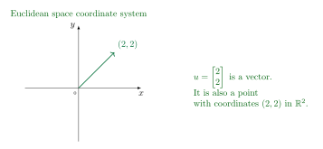
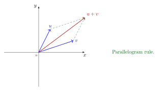
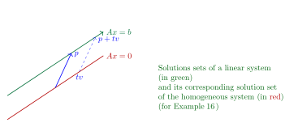
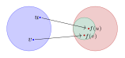

## 1.1 System of linear equations {#section-2}

A *linear equation*  can be written as 

$$
a_1x_1+a_2x_2+\cdots+a_n x_n=b,
$$

where $a_1,\cdots,a_n$ and $b$ are real numbers known in advance.

For example, $4x_1-5x_2+2=x_1$ is a linear equation, $\sqrt 2 x_1+\pi x_2=-1$ is also a linear equation, but $x_1=2x_2x_4$, and $x_2=2\sqrt{x_1}-6$ are not linear equations. 

A *system of linear equations* (or a *linear system*) 
  is a collection of one or more linear equations involving the same variables $x_1,\cdots,x_n$. For example 

$$
\left\{
\begin{array}{l}
2x_1-x_2+1.5 x_3=8\\
x_1-4x_3=-7
\end{array}
\right.
$$

is a linear system.

A *solution*  to a linear system is a list of numbers $(s_1,\cdots, s_n)$ that make each equation a true statement. The set of all possible solutions is called a *solution set*. 

### Geometric interpretation {#section-3}

 As we have learned in analytic geometry, the solution of  a linear system in two variables can have 

1.  exactly one solution (when two lines intersect at a unique point)

2.  infinitely many solutions (two lines coincide)

3.  no solution (two lines are parallel but not the same)

  
  {fig-alt="Three coordinate-plane sketches: intersecting lines have one solution, coincident lines have infinitely many solutions, and parallel distinct lines have no solution." width="65%"}

 
     

::: {.numbered-figure-caption}
**Figure 1.** Examples of one solution, infinitely many solutions and no solution for $2\times 2$ systems.
:::

### Matrix notations {#section-4}

 Consider the linear system

$$
\begin{matrix}
x_1 & - &2x_2&+&x_3&=&0\\
&&2x_2&-&8x_3&=&8\\
5x_1&&&&-5x_3&=&10
\end{matrix}
$$

with the coefficients of each variable aligned in columns

$$
\begin{bmatrix}
1&-2&1\\
0&2&-8\\
5&0&-5
\end{bmatrix}.
$$

This is called the *coefficient matrix*  (or matrix of coefficients), and 

$$
\begin{bmatrix}
1&-2&1&0\\
0&2&-8&8\\
5&0&-5&10
\end{bmatrix}
$$

is called the *augmented matrix*. 

### How to solve a linear system? {#section-5}

::: {.math-block .example}

**Example.**  Solve  the linear system

$$
\begin{matrix}
x_1&-&2x_2&+&x_3&=&0\\
&&2x_2&-&8x_3&=&8\\
5x_1&&&-&5x_3&=&10
\end{matrix}.
$$

 

We copy the linear system below, with the corresponding augmented matrix on the right.

$$
\begin{matrix}
x_1&-&2x_2&+&x_3&=&0\\
&&2x_2&-&8x_3&=&8\\
5x_1&&&-&5x_3&=&10
\end{matrix}
\qquad \qquad
\color{#703080}
\begin{bmatrix}
1&-2&1&0\\
0&2&-8&8\\
5&0&-5&10
\end{bmatrix}\color{#000000}
$$

 
Using the Gaussian elimination method, we eliminate $5x_1$ in the third equation by multiplying the first equation by $-5$ and then adding it to the third equation.

$$
\begin{matrix}
x_1&-&2x_2&+&x_3&=&0\\
&&2x_2&-&8x_3&=&8\\
&&10x_2&-&10x_3&=&10
\end{matrix}
\qquad \qquad
\color{#703080}
\begin{bmatrix}
1&-2&1&0\\
0&2&-8&8\\
0&10&-10&10
\end{bmatrix}\color{#000000}
$$

 
Here we see that for each step of the elimination method we use for the linear system, we have the corresponding operation to the augmented matrix. Continuing the steps, we have 

$$
\begin{matrix}
x_1&-&2x_2&+&x_3&=&0\\
&&x_2&-&4x_3&=&4\\
&&10x_2&-&10x_3&=&10
\end{matrix}
\qquad \qquad
\color{#703080}
\begin{bmatrix}
1&-2&1&0\\
0&1&-4&4\\
0&10&-10&10
\end{bmatrix}\color{#000000}
$$

 
and

$$
\begin{matrix}
x_1&-&2x_2&+&x_3&=&0\\
&&x_2&-&4x_3&=&4\\
&&&&30x_3&=&-30
\end{matrix}
\qquad \qquad
\color{#703080}
\begin{bmatrix}
1&-2&1&0\\
0&1&-4&4\\
0&0&30&-30
\end{bmatrix}\color{#000000}
$$

 
and

$$
\begin{matrix}
x_1&-&2x_2&+&x_3&=&0\\
&&x_2&-&4x_3&=&4\\
&&&&x_3&=&-1
\end{matrix}
\qquad \qquad
\color{#703080}
\begin{bmatrix}
1&-2&1&0\\
0&1&-4&4\\
0&0&1&-1
\end{bmatrix}\color{#000000}
$$

 
and

$$
\begin{matrix}
x_1&-&2x_2&&&=&1\\
&&x_2&&&=&0\\
&&&&x_3&=&-1
\end{matrix}
\qquad \qquad
 \color{#703080}
\begin{bmatrix}
1&-2&0&1\\
0&1&0&0\\
0&0&1&-1
\end{bmatrix}\color{#000000}
$$

 
and

$$
\begin{matrix}
x_1&&&&&=&1\\
&&x_2&&&=&0\\
&&&&x_3&=&-1
\end{matrix}
\qquad \qquad
\color{#703080}
\begin{bmatrix}
1&0&0&1\\
0&1&0&0\\
0&0&1&-1
\end{bmatrix}\color{#000000}
$$

 
Thus, the solution of the linear system is $(x_1,x_2,x_3)=(1,0,-1)$.

:::

### Elementary row operations {#section-6}

 

1.  (Replacement)  Replace one row by the sum of itself and a multiple of another row.

2.  (Interchange)  Interchange two rows.

3.  (Scaling)  Multiply all entries in a row by a non-zero constant.

Two linear systems are *equivalent*,  if one of them is obtained from the other by finitely many steps of row operations. Two equivalent 
linear systems have the same solution set. 

### Existence and uniqueness questions {#section-7}

1.  Does the solution exist? (Existence question)

2.  If a solution exists, is it the only solution? That is, is the solution unique? (Uniqueness question)

If a linear system doesn't have a solution, we call the system *inconsistent*;  otherwise, the system is called *consistent*.  

::: {.math-block .example}

**Example.**  Determine if the following system is consistent.

$$
\begin{matrix}
x_1&-&2x_2&+&x_3&=& 0\\
&&2x_2&-&8x_3&=&8\\
5x_1&&&-&5x_3&=&10
\end{matrix}.
$$

:::

::: {.math-block .proof}

  By the conclusion of the above example, the system is consistent, and the solution is unique. $\square$

:::

::: {.math-block .example}

**Example.** 
Determine if the following system is consistent.

$$
\begin{matrix}
&&x_2&-&4x_3&=&8\\
2x_1&-&3x_2&+&2x_3&=&1\\
4x_1&-&8x_2&+&12x_3&=&1
\end{matrix}.
$$

:::

::: {.math-block .proof}

  The augmented matrix is 

$$
A=
\begin{bmatrix}
0&1&-4&8\\
2&-3&2&1\\
4&-8&12&1
\end{bmatrix}.
$$

Using the elementary row operations, we obtain

$$
\begin{aligned}
&A\rightarrow
\begin{bmatrix}
0&1&-4&8\\
2&-3&2&1\\
4&-8&12&1
\end{bmatrix}
\rightarrow
\begin{bmatrix}
2&-3&2&1\\
0&1&-4&8\\
4&-8&12&1
\end{bmatrix}\\& 
\rightarrow
\begin{bmatrix}
2&-3&2&1\\
0&1&-4&8\\
0&-2&8&-1
\end{bmatrix}\to
\begin{bmatrix}
2&-3&2&1\\
0&1&-4&8\\
0&0&0&15
\end{bmatrix}.
\end{aligned}
$$

The corresponding linear system becomes

$$
\begin{matrix}
2x_1&-&3x_2&+&2x_3&=&1\\
&&x_2&-&4x_3&=&8\\
&&&& {\color{#0000CC}0} x_3&=&{\color{#0000CC}15}
\end{matrix}.
$$

Since $0\neq 15$, the system is inconsistent.
 $\square$

:::

 As we can see, to determine whether a system is consistent, sometimes we don't have to solve it completely.

If it has at least one solution, we say that the linear system satisfies the *existence*  property; if it has at most one solution, we say that the linear system satisfies the *uniqueness*  property.

**Important warning:** If a linear system satisfies the uniqueness property, then either it has one solution or it has no solution. This is the definition of uniqueness.

The concepts of existence, uniqueness, consistency, and inconsistency are related as follows:

1.  A system with infinitely many solutions has existence and consistency, but not uniqueness.

2.  A system with one solution has existence, uniqueness, and consistency.

3.  A system with no solutions has uniqueness and inconsistency, but not existence.

## 1.2 Row reduction and echelon forms {#section-8}

::: {.math-block .definition}

**Definition 1.** 
A matrix is in echelon form,  if

1.  all non-zero rows[^1] are above all zero rows;

2.  each leading entry of a row is in a column to the right of the column of the leading entry of the row above it;

3.  all entries in a column below a leading entry are zero.

If a matrix in echelon form satisfies the following additional conditions, then it is called a reduced echelon form. 

4. the leading entry in each non-zero row is $1$;

5. each leading entry $1$ is the only non-zero entry in its column. 

:::

 Note that the echelon form may not be unique, but the reduced echelon form is.

Once the reduced echelon is reached, the solution set of the linear system can be found. 

::: {.math-block .example}

**Example.** 
Row reduce the matrix $A$ below to its echelon form and locate the pivot columns of $A$, where

$$
A=
\begin{bmatrix}
0&-3&-6&4&9\\
-1&-2&-1&3&1\\
-2&-3&0&3&-1\\
1&4&5&-9&-7
\end{bmatrix}.
$$

The first column is the first pivot column, and the zero in the first row is the initial pivot position.

:::

::: {.math-block .proof}

 
Interchange rows $R_1$ and $R_4$:

$$
\begin{bmatrix}
1&4&5&-9&-7\\
-1&-2&-1&3&1\\
-2&-3&0&3&-1\\
0&-3&-6&4&9
\end{bmatrix}.
$$

Next, replace $R_2$ by $R_1+R_2$ and replace $R_3$ by $2R_1+R_3$:

$$
\begin{bmatrix}
1&4&5&-9&-7\\
0&2&4&-6&-6\\
0&5&10&-15&-15\\
0&-3&-6&4&9
\end{bmatrix}.
$$

Then replace $R_3$ by $-\frac52R_2+R_3$ and replace $R_4$ by $\frac32R_2+R_4$:

$$
\begin{bmatrix}
1&4&5&-9&-7\\
0&2&4&-6&-6\\
0&0&0&0&0\\
0&0&0&-5&0
\end{bmatrix}.
$$

Finally, interchange rows $R_3$ and $R_4$:

$$
\begin{bmatrix}
1&4&5&-9&-7\\
0&2&4&-6&-6\\
0&0&0&-5&0\\
0&0&0&0&0
\end{bmatrix}.
$$

The pivot columns are columns $1$, $2$, and $4$.
 $\square$

:::

### The row operations algorithm {#section-9}

  ****Step 1****  Begin with the left-most *non-zero* column. This is the *pivot column*,  and the pivot position is at the top. 

  ****Step 2****  Select a non-zero entry in the pivot column as a *pivot*  (if necessary, interchange rows to move this entry to the *pivot position*). 

  ****Step 3****  Use the row replacement operations to create zeros in all positions below the pivot.

  ****Step 4****  Cover (or ignore) the row containing the pivot position and all rows, if any, above it. Repeat Steps 1–3. 

  ****Step 5****  Begin with the right-most pivot and work upward and to the left, creating zeros above each pivot. If a pivot is not $1$, make it $1$ by a scaling operation.

The last step is also called *back substitution*.

We shall use the following example to walk through the above steps. 

::: {.math-block .example}

**Example.** 
Apply elementary row operations to transform the following matrix first into echelon form and then into the reduced echelon form.

$$
A=
\begin{bmatrix}
0&3&-6&6&4&-5\\
3&-7&8&-5&8&9\\
3&-9&12&-9&6&15
\end{bmatrix}
$$

:::

::: {.math-block .solution}

We begin with the given matrix:

$$
\begin{bmatrix}
0&3&-6&6&4&-5\\
3&-7&8&-5&8&9\\
3&-9&12&-9&6&15
\end{bmatrix}
$$

**Step 1.** The first column is the pivot column. The zero in the first row is the pivot position, but it is not a pivot. Interchange the first and third rows.   

$$
\begin{bmatrix}
3&-9&12&-9&6&15\\
3&-7&8&-5&8&9\\
0&3&-6&6&4&-5
\end{bmatrix}
$$

**Step 2.** Use row replacement operations to make the two entries below the pivot zero.

$$
\begin{bmatrix}
3&-9&12&-9&6&15\\
0&2&-4&4&2&-6\\
0&3&-6&6&4&-5
\end{bmatrix}
$$

 **Step 3.** Cover the first row and column and repeat the above elimination process. The second column is the new pivot column, and $2$ is the pivot.

$$
\begin{bmatrix}
3&-9&12&-9&6&15\\
0&2&-4&4&2&-6\\
0&0&0&0&1&4
\end{bmatrix}
$$

The matrix is now in echelon form. The $1$ in the last row is the third pivot, and the fifth column is its pivot column. Now we enter the back substitution process.

**Step 4.** Make the pivots equal to $1$.

$$
\begin{bmatrix}
1&-3&4&-3&2&5\\
0&1&-2&2&1&-3\\
0&0&0&0&1&4
\end{bmatrix}
$$

 **Step 5.** Perform back substitution starting from the pivot on the third row and then the pivot on the second row.

$$
\begin{bmatrix}
1&0&-2&3&0&-24\\
0&1&-2&2&0&-7\\
0&0&0&0&1&4
\end{bmatrix}
$$

Reduced echelon form reached.

The last matrix is the reduced echelon form of matrix $A$.
 

:::

::: {.math-block .theorem}

**Theorem 1.** 
Each matrix is row equivalent to one and only one reduced echelon matrix.

:::

**Warning:** However, the echelon form of a matrix is, in general, not unique.

### Solutions of linear system {#section-10}

When the augmented matrix is transformed into the reduced echelon form, we need to re-translate it into a linear system in order to solve the system. 

We consider the following augmented matrix in the reduced echelon form:

$$
\begin{bmatrix}
1&0&-5&1\\
0&1&1&4\\
0&0&0&0
\end{bmatrix}
$$

which corresponds to the linear system

$$
\begin{matrix}
x_1&&&-&5x_3&=&1\\
&&x_2&+&x_3&=&4\\
&&&&0&=&0
\end{matrix}
$$

The variables $x_1,x_2$ corresponding to the pivot columns are called *basic variables* ; the remaining variable, $x_3$, is called a *free variable*. 

The solution of the above system can be written as 

$$
\left\{
\begin{array}{l}
x_1=1+5x_3\\
x_2=4-x_3\\
x_3 \text{ is free}
\end{array}
\right.
$$

This is called the *parametric* description of the solution set. 

::: {.math-block .example}

**Example.** 
Find the general solution(s) of the linear system whose augmented matrix has been reduced to 

$$
A=
\begin{bmatrix}
1&6&2&-5&-2&-4\\
0&0&2&-8&-1&3\\
0&0&0&0&1&7
\end{bmatrix}
$$

:::

::: {.math-block .proof}

 
We need to reduce the matrix to its reduced echelon form:

$$
\begin{aligned}
&A\rightarrow 
\begin{bmatrix}
1&6&2&-5&0&10\\
0&0&2&-8&0&10\\
0&0&0&0&1&7
\end{bmatrix}\\&\rightarrow
\begin{bmatrix}
1&6&2&-5&0&10\\
0&0&1&-4&0&5\\
0&0&0&0&1&7
\end{bmatrix}
\rightarrow
\begin{bmatrix}
1&6&0&3&0&0\\
0&0&1&-4&0&5\\
0&0&0&0&1&7
\end{bmatrix}.
\end{aligned}
$$

Thus we have

$$
\begin{matrix}
x_1&+&6x_2&&&&+3x_4&&=&0\\
&&&&x_3&-&4x_4&&=&5\\
&&&&&&&x_5&=&7
\end{matrix}
$$

So the solutions can be given by

$$
\left\{
\begin{array}{l}
x_1=-6x_2-3x_4\\
x_2 \text{ is free}\\
x_3=5+4x_4\\
x_4 \text{ is free}\\
x_5=7
\end{array}
\right.,
$$

where $x_1,x_3,x_5$ are basic variables, and $x_2,x_4$ are free variables. 
 $\square$

:::

::: {.math-block .example}

**Example.**  Solve

$$
x_1+x_2=1
$$

:::

::: {.math-block .proof}

 
The augmented matrix

$$
[1,1,1]
$$

is already in its reduced echelon form. So the solution is 

$$
\left\{
\begin{array}{l}
x_1=1-x_2\\
x_2 \text{ is free}
\end{array}
\right.
$$

 $\square$

:::

 Note that in the above example, by our algorithm, we must write $x_1=1-x_2$, where $x_1$ is the basic variable and $x_2$ is the free variable, even though $x_2=1-x_1$ is mathematically correct.

### Existence and Uniqueness Questions {#section-11}

 Existence: A linear system is inconsistent, if and only if, in its echelon form, there is a row
like

$$
[0,\cdots,0,b],
$$

where $b\neq 0$. If a system is *not* inconsistent, then the solution(s) exist. 

 Uniqueness: Either no solution, or there is a solution but no free variable(s).

**Important warning:** Note that the last column, or the augmented column, is special. We don't consider it a pivot column *if we are working on the augmented matrix of a linear system.* For row operations on a general matrix, where its last column is not special, it should be counted as a candidate for a pivot column. 

## 1.3 Vector equations {#section-12}

A matrix with only one column is called a *column vector*, or simply a *vector*.   For example,

$$
u=\begin{bmatrix}3\\1\end{bmatrix},\quad v=\begin{bmatrix}0.2\\0.3\end{bmatrix},\quad
w=\begin{bmatrix}w_1\\w_2\end{bmatrix}
$$

are examples of column vectors.

The number of components is called the *dimension*  of a vector. For example, $v=\begin{bmatrix} 1\\2\\3\end{bmatrix}$ is a $3$-dimensional vector. 

We use $\mathbb R^n$ to denote the set of all $n$-dimensional vectors. We call  $\mathbb R^n$ the *$n$-dimensional Euclidean space*.  Two dimensional Euclidean space is also called the  *Euclidean plane*. 

In geometry, a vector can be represented by an arrow from the origin of the coordinate system, as shown in the following graph. 

{fig-alt="Coordinate axes with the vector from the origin to the point (2,2). The vector is also the point with coordinates (2,2) in R squared." width="70%"}

::: {.numbered-figure-caption}
**Figure 2.** Euclidean Coordinate System
:::

Two vectors are equal, if their corresponding entries are equal. For example, the vectors $u_1,u_2$ in the following

$$
u_1=\begin{bmatrix}4\\7\end{bmatrix},\quad u_2=\begin{bmatrix}4\\7\end{bmatrix},\quad
u_3=\begin{bmatrix}7\\4\end{bmatrix}
$$

are equal, but $u_1\neq u_3$.

We define the addition and scalar multiplication of vectors as in the following examples

$$
\begin{aligned}
&\begin{bmatrix}1\\-2\end{bmatrix}+\begin{bmatrix}2\\5\end{bmatrix}=\begin{bmatrix}1+2\\-2+5\end{bmatrix}=\begin{bmatrix}3\\3\end{bmatrix};\\
&2\begin{bmatrix}1\\-2\end{bmatrix}=\begin{bmatrix}2\cdot 1\\2\cdot(-2)\end{bmatrix}=\begin{bmatrix}2\\-4\end{bmatrix}.
\end{aligned}
$$

 The above descriptive way of defining the addition and scalar multiplication is one of the milestones in mathematics, because for the first time, one can do algebra not just on real numbers.

::: {.math-block .example}

**Example.** 
Given

$$
u=\begin{bmatrix}1\\-2\end{bmatrix},\quad v=\begin{bmatrix}2\\-5\end{bmatrix}
$$

find $4u$, $(-3)v$, and $4u+(-3)v$.

:::

::: {.math-block .solution}

  We have

$$
\begin{aligned}
&4u=\begin{bmatrix}4\\-8\end{bmatrix},\quad (-3)v=\begin{bmatrix}-6\\15\end{bmatrix},\\
&4u+(-3)v=\begin{bmatrix}4\\-8\end{bmatrix}+\begin{bmatrix}-6\\15\end{bmatrix}
=\begin{bmatrix}-2\\7\end{bmatrix}.
\end{aligned}
$$

 $\square$

:::

### Geometric interpretation of the rule of addition {#section-13}

The diagram below illustrates vector addition.

{fig-alt="Parallelogram rule: vectors u and v form adjacent sides, and their sum u plus v is the diagonal from the origin." width="70%"}

::: {.numbered-figure-caption}
**Figure 3.** Parallelogram Rule
:::

As mentioned before, two-dimensional Euclidean space is represented by $\mathbb{R}^2$. Let $n$ be a positive integer. We denote $\mathbb{R}^n$  to be the collection of all lists of $n$ real numbers. Thus, an element of $\mathbb{R}^n$ can be represented by

$$
u=\begin{bmatrix}u_1\\u_2\\\vdots\\u_n\end{bmatrix}.
$$

Note that $\mathbb{R}^1=\mathbb{R}$. 

### Algebraic properties of $\mathbb{R}^n$: {#section-14}

 For all $u,v,w$ in $\mathbb{R}^n$, and for all scalar $c,d$ in $\mathbb{R}$, we have

1. $u+v=v+u$

2. $(u+v)+w=u+(v+w)$

3. $u+0=0+u=u$

4. $u+(-u)=-u+u=0$, where $-u=(-1)\cdot u$

5. $c(u+v)=cu+cv$

6. $(c+d)u=cu+du$

7. $c(du)=(cd)u$

8. $1u=u$

### Linear combinations {#section-15}

Given vectors $v_1,\cdots,v_p$ in $\mathbb{R}^n$ and given scalars $c_1,\cdots, c_p$ in $\mathbb{R}$, the vector $y$ defined by

$$
y=c_1v_1+\cdots +c_p v_p
$$

is called a  *linear combination* of $v_1,\cdots, v_p$ with weights $c_1,\cdots, c_p$.

For example, $\sqrt 3v_1+v_2, \frac 12 v_1, 0$($=0\cdot v_1+0\cdot v_2$) are linear combinations of vectors $v_1$ and $v_2$.

::: {.math-block .example}

**Example.**  Let

$$
a_1=\begin{bmatrix}1\\-2\\-5\end{bmatrix},\quad a_2=\begin{bmatrix}2\\5\\6\end{bmatrix},\quad
b=\begin{bmatrix} 7\\4\\-3\end{bmatrix}.
$$

Determine whether $b$ can be generated as a linear combination of $a_1,a_2$.

:::

::: {.math-block .solution}

We take real numbers $x_1,x_2$ to set up the equation

$$
x_1a_1+x_2a_2=b
$$

which is
equivalent to 

$$
x_1\begin{bmatrix}1\\-2\\-5\end{bmatrix}+x_2\begin{bmatrix}2\\5\\6\end{bmatrix}=\begin{bmatrix} 7\\4\\-3\end{bmatrix}
$$

The above equation can be translated to 

$$
\begin{matrix}
x_1&+&2x_2&=&7\\
-2x_1&+&5x_2&=&4\\
-5x_1&+&6x_2&=&-3
\end{matrix}
$$

The augmented matrix is given by

$$
A=\begin{bmatrix}
1&2&7\\-2&5&4\\-5&6&-3\end{bmatrix}
$$

Using the row operations, we have

$$
A\rightarrow\begin{bmatrix}
1&2&7\\0&9&18\\0&16&32\end{bmatrix}
\rightarrow
\begin{bmatrix}
1&2&7\\0&1&2\\0&16&32\end{bmatrix}
\rightarrow
\begin{bmatrix}
1&2&7\\0&1&2\\0&0&0\end{bmatrix}
$$

Answer: yes, it is possible to write $b$ as a linear combination of $a_1$ and $a_2$.
 $\square$

:::

Using vector notation, a system of linear equations can be written as a single vector equation.
The vector equation

$$
x_1a_1+\cdots+x_n a_n=b
$$

has the same solution set as the linear system whose  augmented matrix is of the form

$$
[a_1,\cdots,a_n,b]
$$

::: {.math-block .definition}

**Definition 2.** 
If $v_1,\cdots,v_p$ are in $\mathbb{R}^n$, then the set of all linear combinations of $v_1,\cdots, v_p$ is denoted by    ${\color{#B40000}\operatorname{span}\{v_1,\ldots,v_p\}}$, which is the collection of all vectors that can be written  in the form

$$
c_1v_1+\cdots +c_p v_p 
$$

with $c_1,\cdots, c_p$ being scalars (or weights)  as before. 

:::

 

## 1.4 The matrix equation $Ax=b$ {#section-16}

::: {.math-block .definition}

**Definition 3.** 
If $A$ is an $m\times n$ matrix, with columns $a_1,\cdots, a_n$ and if $x$ is in $\mathbb{R}^n$, then the product of $A$ and $x$,  denoted by $Ax$, is the linear combination of the columns of $A$ using the corresponding entries in $x$ as weights, that is, 

$$
Ax=[a_1,\cdots,a_n]\begin{bmatrix}x_1\\\vdots\\x_n\end{bmatrix}=x_1a_1+x_2a_2+\cdots
+x_na_n
$$

:::

::: {.math-block .example}

**Example.** 

$$
\begin{aligned}
&
\begin{bmatrix}1&2&-1\\0&-5&3\end{bmatrix}\begin{bmatrix}4\\3\\7\end{bmatrix}
=4\begin{bmatrix}1\\0\end{bmatrix}+3\begin{bmatrix}2\\-5\end{bmatrix}+7\begin{bmatrix}-1\\3\end{bmatrix}\\
&=\begin{bmatrix}4\\0\end{bmatrix}+\begin{bmatrix}6\\-15\end{bmatrix}+\begin{bmatrix}-7\\21\end{bmatrix}=\begin{bmatrix}3\\6\end{bmatrix}
\end{aligned}
$$

:::

::: {.math-block .example}

**Example.**  For $v_1,v_2,v_3$ in $\mathbb{R}^m$ for some positive integer $m$, write the linear combination $3v_1-5v_2+7v_3$ as a matrix times a vector.

:::

::: {.math-block .solution}

We write

$$
A=[v_1, v_2,v_3],
$$

and

$$
x=\begin{bmatrix}3\\-5\\7\end{bmatrix}.
$$

Then

$$
3v_1-5v_2+7v_3=Ax.
$$

 $\square$

:::

Let

$$
A=[a_1,\cdots,a_n]
$$

Then the vector equation

$$
x_1a_1+x_2a_2+\cdots+x_na_n=b
$$

can be written as 

$$
Ax=b
$$

By  definition of $Ax$, we have

The equation $Ax=b$ has a solution if and only if $b$ is a linear combination of the columns of $A$.

::: {.math-block .example}

**Example.**  Let

$$
A=\begin{bmatrix} 1&3&4\\-4&2&-6\\-3&-2&-7\end{bmatrix},\qquad 
b=\begin{bmatrix} b_1\\b_2\\b_3\end{bmatrix}.
$$

Is the equation $Ax=b$ consistent for all possible $b_1,b_2, b_3$?

:::

::: {.math-block .solution}

Even though there are symbols in the augmented matrix, we can still do the row operations as usual.

$$
\begin{aligned}
&
\begin{bmatrix}
1&3&4&b_1\\-4&2&-6&b_2\\-3&-2&-7&b_3\\\end{bmatrix}
\rightarrow
\begin{bmatrix}
1&3&4&b_1\\0&14&10&b_2+4b_1\\0&7&5&b_3+3b_1\end{bmatrix}\\[2ex]
&
\rightarrow
\begin{bmatrix}
1&3&4&b_1\\0&14&10&b_2+4b_1\\0&0&0&b_3+3b_1-\frac 12(b_2+4b_1)\end{bmatrix}.
\end{aligned}
$$

Thus the system $Ax=b$ is *not* consistent for any $b$ such that 

$$
b_3+3b_1-\frac 12(b_2+4b_1)\neq 0
$$

 $\square$

:::

::: {.math-block .theorem}

**Theorem 2.** 
Let $A$ be an $m\times n$ matrix. Then the following statements are logically equivalent

1.  for each $b$ in $\mathbb{R}^m$, the equation $Ax=b$ has a solution.

2.  each $b$ in $\mathbb{R}^m$ is a linear combination of the columns of $A$.

3.  the columns of $A$ span $\mathbb{R}^m$.

4.  $A$ has a pivot position in every row.

:::

### The row-vector rule for computing $Ax$ {#section-17}

We use the following example to illustrate the matrix-vector product.

::: {.math-block .example}

**Example.**  We have

$$
\begin{bmatrix}
1&2&-1\\0&-5&3
\end{bmatrix}
\begin{bmatrix}
\red{4}\\\red{3}\\\red{7}
\end{bmatrix}
=
\begin{bmatrix}
1\cdot \red{4}+2\cdot \red{3}+(-1)\cdot \red{7}\\
0\cdot \red{4}+(-5)\cdot \red{3}+3\cdot \red{7}
\end{bmatrix}
=\begin{bmatrix}
3\\6
\end{bmatrix}
$$

and

$$
\begin{bmatrix}
2&-3\\8&0\\-5&2
\end{bmatrix}
\begin{bmatrix}
\red{4}\\\red{7}
\end{bmatrix}
=
\begin{bmatrix}
2\cdot \red{4}+(-3)\cdot \red{7}\\
8\cdot\red{4}+0\cdot\red{7}\\
(-5)\cdot \red{4}+2\cdot \red{7}
\end{bmatrix}
=
\begin{bmatrix}
-13\\32\\-6
\end{bmatrix}
$$

:::

### Properties of matrix multiplication {#section-18}

Let $A$ be an $m\times n$ matrix and let $u$ be  an $n$-dimensional vector. Then $Au$ is an $m$-dimensional vector. 

1.  $A(u+v)=Au+Av$.

2.  $A(cu)=c(Au)$.

The above properties describe the *linearity* of the matrix-vector product. 

## 1.5 Solution set of linear systems {#section-19}

### Homogeneous linear systems {#section-20}

 A linear system of the form $Ax=0$ is called a *homogeneous linear system*. 

Alternatively, a linear system $Ax=b$ when $b\neq 0$ is called a 
*non-homogeneous linear system*. 

A homogeneous linear system always has a solution. In fact, $0$ is always a solution. Such a solution is called the *trivial solution*.  For a homogeneous linear system, we are interested in nonzero solutions, or *non-trivial solutions*. 

::: {.math-block .example}

**Example.** 
Determine if the following homogeneous linear system has a non-trivial solution. Then describe the solution set.

$$
\begin{matrix}
3x_1&+&5x_2&-&4x_3&=&0\\
-3x_1&-&2x_2&+&4x_3&=&0\\
6x_1&+&x_2&-&8x_3&=&0
\end{matrix}
$$

 

:::

::: {.math-block .solution}

Let $A$ be the coefficient matrix of the linear system. Then the augmented matrix is $[A,0]$. 
We perform the row operations

$$
\begin{aligned}
&\begin{bmatrix}
3&5&-4&0\\-3&-2&4&0\\6&1&-8&0\end{bmatrix}\rightarrow
\begin{bmatrix}3&5&-4&0\\0&3&0&0\\0&-9&0&0\end{bmatrix}\to
\begin{bmatrix}3&5&-4&0\\0&3&0&0\\0&0&0&0\end{bmatrix}\\[.2cm]
&\to \begin{bmatrix}1&\frac 53&-\frac 43&0\\0&1&0&0\\0&0&0&0\end{bmatrix}
\to \underset{
\hspace{-0.6cm}\lower0.2cm\hbox{$\green{\substack{
{\Large\boldsymbol{\uparrow}}\quad{\hspace{-.1cm}\Large\boldsymbol{\uparrow}}\\[.2cm]
{\large\textbf{pivot columns}}
}}$}
\;\phantom{-\frac 43\quad 0}
}{
\begin{bmatrix}
1&0&-\frac 43&0\\
0&1&0&0\\
0&0&0&0
\end{bmatrix}}
\end{aligned}
$$

Thus we have

$$
\begin{aligned}
&x_1-\frac 43 x_3=0\\
&x_2=0\\
&0=0
\end{aligned}
$$

and the solution of the system  is 

$$
\left\{
\begin{array}{l}
x_1=\frac 43 x_3\\
x_2=0\\
x_3 \text{ is free}
\end{array}
\right.
$$

It would be much better if we rewrote the solutions using vector notation. 
The solution can be written as the vector form

$$
x=\begin{bmatrix} x_1\\x_2\\x_3\end{bmatrix}
=\begin{bmatrix} \frac 43 x_3\\0\\x_3\end{bmatrix}
=x_3\begin{bmatrix} \frac 43\\0\\1\end{bmatrix}
$$

From the above computation, we know that all the solutions of the system are proportional to the vector 
$\begin{bmatrix} \frac 43\\0\\1\end{bmatrix}$. The free variable $x_3$ is called a *parameter* . If the parameter is not zero, we get a non-zero solution. 
So the homogeneous system does have non-trivial solutions (in fact, there are infinitely many of them). 

 $\square$

:::

::: {.math-block .example}

**Example.** 
Solve

$$
10x_1-3x_2-2x_3=0.
$$

:::

::: {.math-block .solution}

The augmented matrix of the system is

$$
[A,0]=\begin{bmatrix} 10&-3&-2&0\end{bmatrix}.
$$

The row operation(s) go as follows

$$
[A,0]\to \begin{bmatrix} 1&-\frac{3}{10}&-\frac 15&0\end{bmatrix}.
$$

Thus we have

$$
\left\{
\begin{array}{l}
x_1=\frac 3{10} x_2+\frac 15x_3\\[.7ex]
 x_2  \text{ is free}\\
 x_3  \text{ is free}
\end{array}
\right..
$$

In terms of vector notations, we have

$$
\begin{bmatrix}x_1\\x_2\\x_3\end{bmatrix}
=\begin{bmatrix}\frac 3{10} x_2+\frac 15x_3\\x_2\\x_3\end{bmatrix}
=\begin{bmatrix}\frac 3{10} x_2\\x_2\\0\end{bmatrix}
+
\begin{bmatrix}\frac 15x_3\\0\\x_3\end{bmatrix}=x_2\begin{bmatrix}\frac 3{10}\\1\\0\end{bmatrix}
+ x_3\begin{bmatrix}\frac 15\\0\\1\end{bmatrix}
$$

 $\square$

:::

In the above example, the solutions of the linear system depend on two parameters.

### Solutions of non-homogeneous systems {#section-21}

::: {.math-block .example}

**Example.** 
Describe all solutions  of $Ax=b$, where

$$
A=\begin{bmatrix}3&5&-4\\-3&-2&4\\6&1&-8\end{bmatrix},\quad b=\begin{bmatrix}
7\\-1\\-4\end{bmatrix}.
$$

:::

::: {.math-block .solution}

We observe that the coefficient matrix is the same as in Example [14](#ref-example1). So similarly, 
we use the row operations to obtain

$$
\begin{bmatrix}3&5&-4&7\\-3&-2&4&-1\\6&1&-8&-4\end{bmatrix}
\to
\begin{bmatrix}1&0&-\frac 43&-1\\0&1&0&2\\0&0&0&0\end{bmatrix}.
$$

Thus we recover the linear system as

$$
\left\{
\begin{array}{l}
x_1-\frac 43 x_3=-1
\\
x_2=2\\
0=0
\end{array}
\right..
$$

So the solution of the system can be written as

$$
x=\begin{bmatrix}x_1\\x_2\\x_3\end{bmatrix}
=\begin{bmatrix}-1+\frac 43x_3\\2\\x_3\end{bmatrix}=
\begin{bmatrix}-1\\2\\0\end{bmatrix}+
\begin{bmatrix}\frac 43 x_3\\0\\x_3\end{bmatrix}=\begin{bmatrix}-1\\2\\0\end{bmatrix}+x_3
\begin{bmatrix}\frac 43 \\0\\1\end{bmatrix},
$$

or

$$
\tag{1.5.1}
x=p+tv,
$$

where $t$ is a real number, and 

$$
p=\begin{bmatrix}-1\\2\\0\end{bmatrix},\quad 
v=\begin{bmatrix}\frac 43 \\0\\1\end{bmatrix}
$$

 $\square$

:::

In the expression [(1.5.1)](#ref-eq1), $t$ is the parameter, which runs through all real numbers (it doesn't matter whether we use the symbol $t$ or $x_3$). It can be verified directly that $p$ is a solution of the linear system. On the other hand, the set of all $tv$, where $t$ runs through all real numbers, is the solution set of the homogeneous equation in Example [14](#ref-example1). In general, we have the following.

::: {.math-block .theorem}

**Theorem 3.**   Suppose the equation $Ax=b$ is consistent for some given $b$, and let $p$ be a solution of it. Then the solution set of $Ax=b$ is the set of all vectors of the form $x=p+v_h$, where $v_h$ is any solution of the homogeneous equation $Ax=0$.

:::

The above theorem gives the structure of the solution set of a consistent linear system. 

{fig-alt="The solution set of A x equals b is a line parallel to the homogeneous solution line A x equals zero, translated by the particular solution p." width="70%"}

 *(We will skip § 1.6)*

 

## 1.7 Linear independence {#section-22}

We first work out an example. Let

$$
v_1=\begin{bmatrix}2\\3\end{bmatrix},\quad v_2=\begin{bmatrix}4\\6\end{bmatrix}
$$

Let's find ${\rm span}\{v_1,v_2\}$. 

By definition, the span is the set of all linear combinations

$$
c_1v_1+c_2v_2=c_1\begin{bmatrix}2\\3\end{bmatrix}+c_2
\begin{bmatrix}4\\6\end{bmatrix}=\begin{bmatrix}2c_1+4c_2\\3c_1+6c_2\end{bmatrix}
$$

However, we can simplify it by

$$
\begin{bmatrix}2c_1+4c_2\\3c_1+6c_2\end{bmatrix}=(c_1+2c_2)\begin{bmatrix}2\\3\end{bmatrix}
=(c_1+2c_2)v_1.
$$

Although it looks as though the span is formed from linear combinations of two vectors, ${\rm span}\{v_1,v_2\}$ really is the set of vectors proportional to $v_1$ (and since $v_2=2v_1$, it is also the set of vectors proportional to $v_2$). In fact, one of the two vectors $v_1, v_2$ is redundant. The concepts *linear independence*
 and *linear dependence*
 are defined to capture this phenomenon.

Now we make the following definition.

::: {.math-block .definition}

**Definition 4.** 
An indexed set of vectors $\{v_1,\cdots,v_p\}$ is said to be linearly independent, if the vector equation 

$$
x_1v_1+x_2v_2+\cdots +x_p v_p=0
$$

has the trivial solution only. The set $\{v_1,\cdots, v_p\}$ is said to be linearly dependent if the above equation has non-trivial solutions. In other words, the set is   dependent if  there
exist weights $c_1, \cdots, c_p$, not all of which are zero, such that 

$$
c_1v_1+c_2v_2+\cdots+c_pv_p=0.
$$

The above equation, when $c_1,\cdots, c_p$ are not all zero, is called the *linear dependence relation*. 

:::

 
 From the above definition, we know that $\{v_1,\cdots, v_p\}$ is linearly independent if and only if $Ax=0$ has only the trivial solution, where $A=[v_1, v_2,\cdots,v_p]$.

::: {.math-block .example}

**Example.** 
Let

$$
v_1=\begin{bmatrix}1\\2\\3\end{bmatrix},\quad
v_2=\begin{bmatrix}4\\5\\6\end{bmatrix},\quad
v_3=\begin{bmatrix}2\\1\\0\end{bmatrix}
$$

1.  determine if the set $\{v_1,v_2,v_3\}$ is linearly independent.

2.  if possible, find a linear dependence relation among $v_1,v_2,v_3$.

:::

::: {.math-block .solution}

We must determine if  there is a non-trivial solution of the equation 

$$
x_1v_1+x_2v_2+x_3v_3=0.
$$

In order to do that, we need to do the following row operations

$$
\begin{bmatrix}
1&4&2&0\\2&5&1&0\\3&6&0&0
\end{bmatrix}
\to
\begin{bmatrix}
1&4&2&0\\0&-3&-3&0\\0&-6&-6&0
\end{bmatrix}
\to
\begin{bmatrix}
1&4&2&0\\0&-3&-3&0\\0&0&0&0
\end{bmatrix}
$$

Since  $x_3$ is the free variable, the equation has non-trivial solutions. As a result, $v_1,v_2, v_3$ are linearly dependent. 

In order to find a linear dependence relation, we need to solve the equation. So we further reduce the matrix to reduced row-echelon form. 

$$
\begin{bmatrix}
1&4&2&0\\0&-3&-3&0\\0&0&0&0
\end{bmatrix}
\to
\begin{bmatrix}
1&4&2&0\\0&1&1&0\\0&0&0&0
\end{bmatrix}
\to
\begin{bmatrix}
1&0&-2&0\\0&1&1&0\\0&0&0&0
\end{bmatrix}
$$

Thus we have

$$
\left\{
\begin{array}{l}
x_1-2x_3=0\\
x_2+x_3=0\\
x_3 \text{ is free}
\end{array}
\right.
$$

So the solution is 

$$
\left\{
\begin{array}{l}
x_1=2x_3\\
x_2=-x_3\\
x_3 \text{ is free}
\end{array}
\right.
$$

We take $x_3=1$ to obtain a nonzero solution $\begin{bmatrix}x_1\\x_2\\x_3\end{bmatrix}
=\begin{bmatrix}2\\-1\\1\end{bmatrix}$. Thus, a linear dependence relation is $2v_1-v_2+v_3=0$. 
 $\square$

:::

::: {.math-block .example}

**Example.**  Determine if the columns of the matrix

$$
A=\begin{bmatrix}
0&1&4\\1&2&-1\\5&8&0\end{bmatrix}
$$

are linearly independent.

:::

::: {.math-block .solution}

We consider the system $Ax=0$, and have 

$$
\begin{aligned}
&
[A,0]=\begin{bmatrix}
0&1&4&0\\1&2&-1&0\\5&8&0&0\end{bmatrix}
\to
\begin{bmatrix}
1&2&-1&0\\0&1&4&0\\5&8&0&0\end{bmatrix}\\
&
\to
\begin{bmatrix}
1&2&-1&0\\0&1&4&0\\0&-2&5&0\end{bmatrix}\to 
\begin{bmatrix}
1&2&-1&0\\0&1&4&0\\0&0&13&0\end{bmatrix}.
\end{aligned}
$$

Since there is no free variable, the columns are linearly independent. 

 $\square$

:::

### Some discussions {#section-23}

 Let $v_1,v_2$ be two vectors. Assume that $\{v_1,v_2\}$ is linearly dependent. Then there exist $c_1,c_2$, not simultaneously equal to zero, such that 

$$
c_1v_1+c_2v_2=0.
$$

By this equation, if $c_2\neq 0$, then we can write $v_2=-c_1/c_2 v_1$, but if $c_2=0$, then $c_1$ must not be zero, and hence $v_1=-c_2/c_1v_2$. In both cases, we conclude that the two vectors must be proportional, if they are linearly dependent. 

If the single-vector set $\{v\}$ is linearly dependent, then there exists a scalar $c\neq 0$ such that $cv=0$. Since $c\neq 0$, we must have $v=0$. Conversely, if $v=0$, then $1\cdot v=0$ is a non-trivial linear dependence relation. Thus a single vector $v$ is linearly independent if and only if $v\neq 0$.

It is much more difficult to characterize the linear independence property for a set of more than two vectors. But by 
the above discussion, we have

::: {.math-block .theorem}

**Theorem 4 (Characterization of linearly dependent sets).**  An indexed set $S=\{v_1,\cdots,v_p\}$ of two or more vectors
is linearly dependent, if and only if at least one of the vectors in $S$ is a linear combination of the others. 

:::

::: {.math-block .example}

**Example.** 
Let 

$$
u=\begin{bmatrix}3\\1\\0\end{bmatrix},\quad v=\begin{bmatrix}1\\6\\0\end{bmatrix}
$$

Describe the set spanned by $u$ and $v$.

:::

::: {.math-block .solution}

The span is the plane in $\mathbb{R}^3$ defined by the points $(0,0,0)$, $(3,1,0)$, and $(1,6,0)$. Since the third component of the vectors is zero, the span is the $xy$ plane in $\mathbb R^3$.
 $\square$

:::

::: {.math-block .theorem}

**Theorem 5.** 
If a set contains more vectors than there are entries in each vector, then the set is linearly dependent, that is, any set $\{v_1,\cdots,v_p\}$ in $\mathbb{R}^n$ is linearly dependent if $p>n$.

:::

::: {.math-block .proof}

Write $A=[v_1,\cdots,v_p]$. Then $A$ is an $n\times p$ matrix. 
Since there are $n$ rows, there are at most $n$ basic variables. Therefore  free variable(s) do exist. So $Ax=0$ has non-trivial solutions, and $\{v_1,\cdots, v_p\}$ is linearly dependent. 
 $\square$

:::

**Warning:** If $p\leq n$, the above theorem says nothing.

::: {.math-block .theorem}

**Theorem 6.** 
If a set $\{v_1,\cdots, v_p\}$ contains the zero vector, then the set is linearly dependent. 

:::

::: {.math-block .example}

**Example.**  Determine by inspection whether the given set is linearly dependent.

**(1).**  $\begin{bmatrix} 1\\7\\6\end{bmatrix},\,\, \begin{bmatrix} 2\\0\\9\end{bmatrix},\,\,
    \begin{bmatrix} 3\\1\\5\end{bmatrix},\,\,\begin{bmatrix} 4\\1\\8\end{bmatrix}$

 **(2).**  $\begin{bmatrix} 12\\3\\5\end{bmatrix},\,\,\begin{bmatrix} 0\\0\\0\end{bmatrix},\,\,\begin{bmatrix} 1\\1\\8\end{bmatrix}$

 **(3).**  $\begin{bmatrix} -2\\4\\6\\10\end{bmatrix},\,\, \begin{bmatrix} 3\\-6\\-9\\15\end{bmatrix}$

::: {.math-block .solution}

(1) is linearly dependent because it contains four vectors in a three-dimensional space.

(2) is linearly dependent, because it contains the zero vector. 

(3) is linearly independent, because the two vectors are not proportional.

 $\square$

:::

:::

## 1.8 Introduction to linear transformation {#section-24}

We would like to introduce more formally the concept of a *function* .

::: {.math-block .definition}

**Definition 5.** 
A function $f: X\to Y$ is a triple $(f,X,Y)$, where $X,Y$ are two sets, and $f$ is an assignment,  or a rule,  that for any element $x$ in $X$, there is a unique $y=f(x)$ in $Y$ attached to it. 

$X$ is called the domain  of $f$, and $Y$ is called the codomain  of $f$. The range  is the subset of the codomain $Y$ consisting of all $f(x)$ when $x$ is running through $X$. The assignment sometimes is written as $x\mapsto f(x)$. Thus a complete description of a function can be given as

$$
f: X\to Y,\quad x\mapsto f(x).
$$

:::

{fig-alt="A function maps points u and v in the domain X to points f(u) and f(v) in the codomain Y. The range is shown as a subset of Y." width="55%"}

::: {.numbered-figure-caption}
**Figure 4.** A function $f: X \to Y$, where the blue disk is the domain, the red disk is the codomain, and the green disk inside the codomain is the range of the function.
:::

What does it have to do with the functions we are familiar with? For example, $h(x)=x^2$, in Calculus? The *implicit* domain and codomain of the function are $\mathbb{R}$, and the assignment is $x\mapsto x^2$. The range of this function is the set of all non-negative real numbers.

A function sometimes is called a *mapping*, or a *transformation*. In linear algebra, we shall study a function from $\mathbb{R}^n$ to $\mathbb{R}^m$, that is to say, that the domain is $\mathbb{R}^n$, and the codomain is $\mathbb{R}^m$. We often use capital letters to refer to a function or transformation. 

::: {.math-block .example}

**Example.**  The following is an example of a transformation

$$
T:\mathbb{R}^2\to \mathbb{R}^2,\quad T(x_1,x_2)=(x_1+x_2, 3x_2).
$$

:::

The standard way to represent such a transformation is to use column-vector notation. Therefore

$$
T\left(\begin{bmatrix} x_1\\x_2\end{bmatrix}\right)=\begin{bmatrix} x_1+x_2\\3x_2\end{bmatrix}
$$

or

$$
T: \mathbb{R}^2\to\mathbb{R}^2,\quad \begin{bmatrix} x_1\\x_2\end{bmatrix}\mapsto \begin{bmatrix} x_1+x_2\\3x_2\end{bmatrix}
$$

are both legitimate ways to represent the transformation. 

Before formally defining what a linear transformation is, we first study the *matrix transformation*. As is well known, if $A$ is an $m\times n$ matrix, and if $x$ is in $\mathbb{R}^n$, then $Ax$ is in $\mathbb{R}^m$. Therefore, $x\mapsto Ax$ is a transformation, which is called a matrix transformation.

::: {.math-block .example}

**Example.** 
Let

$$
A=\begin{bmatrix} 1&-3\\3&5\\-1&7\end{bmatrix}, u=\begin{bmatrix} 2\\-1\end{bmatrix},
b=\begin{bmatrix} 3\\2\\-5\end{bmatrix},c=\begin{bmatrix} 3\\2\\5\end{bmatrix}
$$

and define a transformation $T:\mathbb{R}^2\to \mathbb{R}^3$ by $T(x)=Ax$.

1.  find $T(u)$, the image of $u$ under the transformation $T$;

2.  find an $x$ in $\mathbb{R}^2$ whose image under $T$ is $b$ (such an $x$, if it exists, is called a preimage  of $b$);

3.  is there more than one $x$ whose image under $T$ is $b$ (are the preimages of $b$ unique)?

4.  determine if $c$ is in the image of the transformation $T$.

:::

::: {.math-block .solution}

(1). We compute 

$$
T(u)=Au=\begin{bmatrix} 1&-3\\3&5\\-1&7\end{bmatrix}\cdot \begin{bmatrix} 2\\-1\end{bmatrix}=
\begin{bmatrix} 5\\1\\-9\end{bmatrix},
$$

which is the image of $u$ under $T$.

(2). Solve $T(x)=b$ for $x$, which is equivalent to solving $Ax=b$:

$$
\begin{bmatrix} 1&-3\\3&5\\-1&7\end{bmatrix}\begin{bmatrix} x_1\\x_2\end{bmatrix}
=
\begin{bmatrix} 3\\2\\-5\end{bmatrix}
$$

Do the row operations

$$
\begin{bmatrix} 1&-3&3\\3&5&2\\-1&7&-5\end{bmatrix}
\to
\begin{bmatrix} 1&-3&3\\0&14&-7\\0&4&-2\end{bmatrix}
\to
\begin{bmatrix} 1&-3&3\\0&1&-\frac 12\\0&0&0\end{bmatrix}
\to
\begin{bmatrix} 1&0&\frac 32\\0&1&-\frac 12\\0&0&0\end{bmatrix}
$$

Therefore, $x=\begin{bmatrix}x_1\\x_2\end{bmatrix}=\begin{bmatrix}\frac 32\\-\frac 12\end{bmatrix}$. The image of $x$ under $T$ is $b$.

(3). Since the above equation has a unique solution, there is exactly one $x$ such that $T(x)=b$.

(4). $c$ is in the range if and only if $T(x)=c$ is solvable. But

$$
\begin{bmatrix} 1&-3&3\\3&5&2\\-1&7&5\end{bmatrix}
\to
\begin{bmatrix} 1&-3&3\\0&14&-7\\0&4&8\end{bmatrix}
\to
\begin{bmatrix} 1&-3&3\\0&1&2\\0&14&-7\end{bmatrix}
\to
\begin{bmatrix} 1&-3&3\\0&1&2\\0&0&-35\end{bmatrix}
$$

Therefore, the system is inconsistent, and hence $c$ is not in the range of $T$.
 $\square$

:::

::: {.math-block .definition}

**Definition 6.** 
A transformation $T: \mathbb{R}^n\to\mathbb{R}^m$ is called linear, if

1.  $T(u+v)=T(u)+T(v)$ for all $u,v$ in $\mathbb{R}^n$.

2.  $T(cu)=cT(u)$ for all $u$ in $\mathbb{R}^n$, $c$ in $\mathbb{R}$.

:::

If $T$ is a linear transformation, then 

$$
T(0+0)=T(0)+T(0)
$$

which implies that $T(0)=0$. The same property can be obtained by 

$$
2T(0)=T(2\cdot 0)=T(0)
$$

also. On the other hand, we have

$$
T(cu+dv)=T(cu)+T(dv)=cT(u)+dT(v).
$$

Moreover, we have

$$
T(c_1v_1+c_2v_2+\cdots+c_pv_p)=c_1T(v_1)+\cdots+c_pT(v_p).
$$

Thus, a linear transformation preserves linear combinations.  

::: {.math-block .example}

**Example.** 
Show that $T(x_1,x_2)=(x_1+x_2, 3x_2)$ is a linear transformation. 

:::

::: {.math-block .solution}

We write $T$ into the standard format

$$
T\left(\begin{bmatrix} x_1\\x_2\end{bmatrix}\right)=\begin{bmatrix} x_1+x_2\\3x_2\end{bmatrix}.
$$

We let $c$ be a real number, and

$$
u=\begin{bmatrix} u_1\\u_2\end{bmatrix},\quad 
v=\begin{bmatrix} v_1\\v_2\end{bmatrix}.
$$

Thus we have

$$
u+v=\begin{bmatrix} u_1+v_1\\u_2+v_2\end{bmatrix}
$$

and hence

$$
T(u+v)=
\begin{bmatrix} (u_1+v_1)+(u_2+v_2)\\3(u_2+v_2)\end{bmatrix}=
\begin{bmatrix} (u_1+u_2)+(v_1+v_2)\\3u_2+3v_2\end{bmatrix}.
$$

On the other hand

$$
T(u)=\begin{bmatrix} u_1+u_2\\3u_2\end{bmatrix},\quad
T(v)=\begin{bmatrix} v_1+v_2\\3v_2\end{bmatrix}
$$

Thus we have verified 

$$
T(u+v)=T(u)+T(v).
$$

Similarly, we compute 

$$
cu=\begin{bmatrix} cu_1\\cu_2\end{bmatrix},\quad
T(cu)=\begin{bmatrix} cu_1+cu_2\\3cu_2\end{bmatrix},\quad
cT(u)=\begin{bmatrix} c(u_1+u_2)\\c\cdot 3u_2\end{bmatrix}
$$

and hence

$$
T(cu)=cT(u).
$$

Therefore, $T$ is a linear transformation. 
 $\square$

:::

On the other hand, if we need to prove a transformation is  not linear, we need to prove that for some concrete vectors, one of the equations in Definition [6](#ref-def-lineart) is invalid.

::: {.math-block .example}

**Example.** 
Prove that the transformation defined by $T(x_1,x_2)=(1+x_1,x_2)$ is not a linear transformation.

:::

::: {.math-block .solution}

Since $T(0,0)=(1,0)\neq (0,0)$, it is not a linear transformation.
 $\square$

:::

::: {.math-block .example}

**Example.** 
Prove that the transformation defined by $T(x_1,x_2)=(|x_1|,x_2)$ is not a linear transformation.

:::

::: {.math-block .solution}

Since $T(-1,0)=(-1)\cdot T(1,0)=-(1,0)$ by the second property of linear transformation, we get a contradiction because by definition, $T(-1,0)=(1,0)$.
 $\square$

:::

## 1.9 The matrix of a  linear transformation {#section-25}

First, we shall show that a matrix transformation must be a linear transformation. Let $c$ be a real number, and let $u,v$ be in $\mathbb{R}^n$. Then we have

$$
\begin{aligned}
& A(u+v)=Au+Av\\
& A(cu)=c(Au)
\end{aligned}
$$

Since $T(x)=Ax$, the above equations are transferred to 

$$
\begin{aligned}
& T(u+v)=T(u)+T(v)\\
& T(cu)=c(T(u))
\end{aligned}
$$

We consider the following inverse problem: let $T:\mathbb{R}^n\to\mathbb{R}^m$ be  a linear transformation, can we 
find an $m\times n$ matrix $A$ such that 

$$
T(x)=Ax
$$

for all $x$ in $\mathbb{R}^n$?

If such  a matrix exists, we call $A$ the *standard matrix, or matrix representative, for the  linear transformation*
  $T$.  

We first study the following example.

::: {.math-block .example}

**Example.** 
We consider the following matrix

$$
\begin{bmatrix} 1&0\\0&1\end{bmatrix}.
$$

Let

$$
e_1=\begin{bmatrix} 1\\0\end{bmatrix},\quad e_2=\begin{bmatrix} 0\\1\end{bmatrix}
$$

be the two columns of the matrix.
Suppose $T$ is a linear transformation $\mathbb{R}^2\to\mathbb{R}^3$ such that 

$$
T(e_1)=\begin{bmatrix} 5\\-7\\2\end{bmatrix}, \quad T(e_2)=\begin{bmatrix} -3\\8\\0\end{bmatrix}.
$$

Find the $3\times 2$ matrix $A$ such that 

$$
T(x)=Ax.
$$

:::

::: {.math-block .solution}

The trick is that the vectors $e_1,e_2$ are special. We write

$$
x=\begin{bmatrix}x_1\\x_2\end{bmatrix}
=x_1\begin{bmatrix}1\\0\end{bmatrix}+x_2\begin{bmatrix}0\\1\end{bmatrix}
=x_1e_1+x_2e_2.
$$

Since $T$ is linear, we must have

$$
T(x)=T(x_1e_1+x_2e_2)=x_1T(e_1)+x_2T(e_2)
=
x_1\begin{bmatrix}5\\-7\\2\end{bmatrix}+x_2\begin{bmatrix}-3\\8\\0\end{bmatrix}
=
\begin{bmatrix}5&-3\\-7&8\\2&0\end{bmatrix}\begin{bmatrix}x_1\\x_2\end{bmatrix}.
$$

Therefore

$$
A=\begin{bmatrix}5&-3\\-7&8\\2&0\end{bmatrix},
$$

and it is exactly $[T(e_1), T(e_2)]$. 
 $\square$

:::

In order to generalize the above method to any linear transformation $\mathbb{R}^n\to \mathbb{R}^m$, we define the so-called identity matrix. We have seen the $2\times 2$ identity matrix $I_2$ above

$$
I_2=\begin{bmatrix}1&0\\0&1\end{bmatrix}.
$$

The $3\times3$ identity matrix is given by 

$$
\begin{bmatrix}1&0&0\\0&1&0\\0&0&1\end{bmatrix}.
$$

The $n\times n$ identity matrix is given by

$$
I_n=
\begin{bmatrix}1\\&1\\&&\ddots\\&&&1\end{bmatrix}.
$$

If we write the columns of $I_n$ as $e_1,\cdots, e_n$, then we have

$$
I_n=[e_1,e_2,\cdots, e_n].
$$

For example,

$$
\blue{e_1=\begin{bmatrix}1\\0\\\vdots\\0\end{bmatrix}},
\red{e_2=\begin{bmatrix}0\\1\\\vdots\\0\end{bmatrix}},\cdots,
\green{e_n=\begin{bmatrix}0\\0\\\vdots\\1\end{bmatrix}}.
$$

Since we have

$$
x=\begin{bmatrix}x_1\\x_2\\\vdots \\x_n\end{bmatrix}=x_1e_1+x_2e_2+\cdots+x_n e_n,
$$

we get 

$$
\begin{aligned}
&
T(x)=T(x_1e_1+\cdots +x_n e_n)=x_1T(e_1)+\cdots+x_n T(e_n)\\
&
=[T(e_1), T(e_2),\cdots, T(e_n)]\begin{bmatrix}x_1\\x_2\\\vdots\\x_n\end{bmatrix}.
\end{aligned}
$$

So

$$
A=[T(e_1), T(e_2),\cdots, T(e_n)].
$$

::: {.math-block .example}

**Example.** 
Find the standard matrix $A$ for the dilation transformation $T:\mathbb{R}^2\to \mathbb{R}^2, T(x)=3x$.

:::

::: {.math-block .solution}

We have

$$
T(e_1)=3e_1=\begin{bmatrix}3\\0\end{bmatrix},\quad
T(e_2)=3e_2=\begin{bmatrix}0\\3\end{bmatrix}.
$$

Therefore, we have

$$
A=\begin{bmatrix}3&0\\0&3\end{bmatrix}.
$$

 $\square$

:::

::: {.math-block .example}

**Example.** 
Let $T: \mathbb{R}^2\to\mathbb{R}^2$ be the transformation that rotates each point in $\mathbb{R}^2$ about the origin through an angle
$\phi$, with counter-clockwise  rotation for a positive angle. Find the standard matrix $A$ of this transformation. 

:::

::: {.math-block .solution}

Since $\begin{bmatrix}1\\0\end{bmatrix}$ rotates into $\begin{bmatrix}\cos\phi\\\sin\phi\end{bmatrix}$, and 
$\begin{bmatrix}0\\1\end{bmatrix}$ rotates into $\begin{bmatrix}-\sin\phi\\\cos\phi\end{bmatrix}$, we have

$$
A=
\begin{bmatrix}
\cos\phi&-\sin\phi\\\sin\phi&\cos\phi
\end{bmatrix}.
$$

The formula of rotation is given by 
the matrix multiplication

$$
\begin{bmatrix}x'\\y'\end{bmatrix}=\begin{bmatrix}
\cos\phi&-\sin\phi\\\sin\phi&\cos\phi
\end{bmatrix}\cdot \begin{bmatrix}x\\y\end{bmatrix}
=\begin{bmatrix}
x\cos\phi-y\sin\phi\\
x\sin\phi+y\cos\phi
\end{bmatrix}.
$$

 $\square$

:::

In the following, we shall use the language of transformation to study the existence and uniqueness questions again.

::: {.math-block .definition}

**Definition 7.** 
A transformation $T: \mathbb{R}^n\to\mathbb{R}^m$ is said to be onto $\mathbb{R}^m$, if each $b$ in $\mathbb{R}^m$ is the image of at least one $x$ in $\mathbb{R}^n$. In other words, the range of the transformation is the same as the codomain.

:::

If $T$ is onto, then the pre-image of any $b$ in $\mathbb{R}^m$ exists. 

::: {.math-block .definition}

**Definition 8.** 
A transformation $T: \mathbb{R}^n\to\mathbb{R}^m$ is said to be one-to-one if each $b$ in $\mathbb{R}^m$ is the image of at most one $x$ in $\mathbb{R}^n$. 

:::

::: {.math-block .example}

**Example.** 
Let $T$ be the linear transformation whose matrix is 

$$
A=
\begin{bmatrix}
1&-4&8&1\\0&2&-1&3\\0&0&0&5\end{bmatrix}
$$

Does $T$ map $\mathbb{R}^4$ onto $\mathbb{R}^3$? Is $T$ a one-to-one mapping?

:::

::: {.math-block .solution}

Since $A$ happens to be in the echelon form, we can see at once that $A$ has a pivot position in each row. Therefore $Ax=b$ has a solution for any $b$ in $\mathbb{R}^3$, hence $T$ is onto. On the other hand, since $Ax=b$ has free variable $x_3$, the map is not one-to-one. 
 $\square$

:::

In summary, let $T:\mathbb{R}^n\to\mathbb{R}^m$ be a linear transformation such that $T(x)=Ax$ for an $m\times n$ matrix $A$ for any $x$ in $\mathbb{R}^n$. Then

1. 
    $T$ is onto $\Longleftrightarrow$ the columns of $A$ span $\mathbb{R}^m$ $\Longleftrightarrow$ each *row* of $A$ has a pivot position;

2.  $T$ is one-to-one $\Longleftrightarrow$ the columns of $A$ are linearly independent $\Longleftrightarrow$ each *column* of $A$ has a pivot position.

In the one-to-one case, by the structure theorem (Theorem [3](#ref-1.21)) for solutions of systems of linear equations, we have a slightly better criterion.

::: {.math-block .theorem}

**Theorem 7.** 
Let $T:\mathbb{R}^n\to \mathbb{R}^m$ be a linear transformation. Then $T$ is one-to-one if and only if $T(x)=0$ has trivial solution only. 

:::

So instead of checking the uniqueness for the equation $T(x)=b$ for any $b$ in $\mathbb{R}^m$, we just need to check the uniqueness for $T(x)=0$.

[^1]: A row of all zero entries is called a zero row; a row is called a nonzero row if at least one of its entries is not zero. For a nonzero row, the first nonzero entry, from left to right, is called the *leading entry*.
