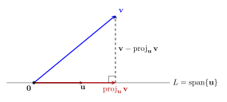

## 6.1 Dot product, length, and orthogonality {#section-50}

::: {.math-block .definition}

**Definition 24.** 
If $u,v$ are vectors in $\mathbb{R}^n$, then we can regard them as $n\times 1$ matrices. The transpose $u^T$ is a $1\times n$ matrix. The multiplication $u^Tv$ is a $1\times 1$ matrix, which is a number and is called the dot product or inner product.
If   

$$
u=\begin{bmatrix} u_1\\\vdots\\u_n\end{bmatrix},\quad
v=\begin{bmatrix} v_1\\\vdots\\v_n\end{bmatrix},
$$

then the dot  product of $u$ and $v$ can be written as 

$$
u\cdot v=[u_1, u_2,\cdots, u_n]\begin{bmatrix} v_1\\\vdots\\v_n \end{bmatrix}
=u_1v_1+u_2v_2+\cdots +u_nv_n.
$$

:::

**Warning:** Let $C=AB$. Then the entry $c_{ij}$ of $C$ is the dot product of the $i$-th row of $A$ and the $j$-th column of $B$.

::: {.math-block .example}

**Example.** 
Compute $u\cdot v$ and $v\cdot u$ for 

$$
u=\begin{bmatrix} 2\\-5\\-1 \end{bmatrix},\quad
v=\begin{bmatrix} 3\\2\\-3 \end{bmatrix}.
$$

:::

::: {.math-block .solution}

We have 

$$
u\cdot v=u^Tv=[2, -5,  -1]\begin{bmatrix}3\\2\\-3  \end{bmatrix}=2\cdot 3+(-5)\cdot 2+(-1)\cdot (-3)=-1,
$$

and $v\cdot u=v^Tu=u^Tv=-1$ as well.

 $\square$

:::

From the above example, we see that $u\cdot v=v\cdot u$. Moreover, we have

::: {.math-block .theorem}

**Theorem 36.** 
Let $u,v$, and $w$ be vectors in $\mathbb{R}^n$, and let $c$ be a scalar. Then

1.  $u\cdot v=v\cdot u$ (symmetry);

2.  $(u+v)\cdot w=u\cdot w+v\cdot w$ (linearity);

3.  $(cu)\cdot v=c(u\cdot v)$ (linearity);

4.  $u\cdot u\geq 0$, and $u\cdot u=0$ if and only if $u=0$ (positivity).

:::

::: {.math-block .definition}

**Definition 25 (The length of a vector).**  The length (or norm) of $v$ is the non-negative scalar $\|v\|$ defined by  

$$
\|v\|=\sqrt{v\cdot v}=\sqrt{v_1^2+v_2^2+\cdots +v_n^2},\quad \|v\|^2=v\cdot v.
$$

:::

::: {.math-block .theorem}

**Theorem 37 (Cauchy-Bunyakovsky-Schwarz Inequality).** 
Let $u,v\in V$. Then

$$
-\|u\|\cdot\|v\|\leq u\cdot v\leq \|u\|\cdot\|v\|.
$$

Equality is valid if and only if $u,v$ are linearly dependent.

:::

::: {.math-block .proof}

Let $t\in\mathbb{R}$ be an arbitrary real number. Then by the positivity of the dot product, we have 

$$
(u+tv)\cdot (u+tv)\geq 0.
$$

Expanding the expression above, we get

$$
\|u\|^2+2 t\,(u\cdot v)+t^2\, \|v\|^2\geq 0.
$$

Since the above is true for any $t$, the discriminant 

$$
4 (u\cdot v)^2-4\|u\|^2\cdot\|v\|^2\leq 0,
$$

which  completes the proof. 
 $\square$

:::

A vector of length $1$ is called a *unit vector*.   If $v\neq 0$, then $\|v\|^{-1} v$ is a unit vector and is called the *normalization* of $v$. 

::: {.math-block .example}

**Example.** 
Let $v=\begin{bmatrix}1\\-2\\2\\0  \end{bmatrix}$. Find a unit vector $u$ in the same direction as $v$.

:::

::: {.math-block .solution}

We compute

$$
\|v\|^2=v\cdot v=1^2+(-2)^2+2^2+0^2=9,
$$

and therefore, $\|v\|=3$. The normalization of $v$ is

$$
u=\frac{v}{\|v\|}=\frac 13 \begin{bmatrix} 1\\-2\\2\\0 \end{bmatrix}
=
\begin{bmatrix}  1/3\\-2/3\\2/3\\0\end{bmatrix}.
$$

$u$ is the unit vector in the same direction as $v$.

 $\square$

:::

Note that $-u$ is also a unit vector linearly dependent on $v$, but it is in the “opposite” direction from $u$.

::: {.math-block .example}

**Example.** 
Let $W$ be the subspace of $\mathbb{R}^2$ spanned by $x=\begin{bmatrix} 2/3\\1 \end{bmatrix}$.  Find a unit vector  $z$ that is a basis for $W$.

:::

::: {.math-block .solution}

We normalize $x$ by

$$
z=\frac{x}{\|x\|}=\frac{1}{\sqrt{(2/3)^2+1}} \begin{bmatrix} 2/3\\1 \end{bmatrix}
=\frac{3}{\sqrt{13}}\begin{bmatrix} 2/3\\1 \end{bmatrix}=
\begin{bmatrix} 2/\sqrt{13}\\3/\sqrt{13} \end{bmatrix}.
$$

 $\square$

:::

::: {.math-block .definition}

**Definition 26 (The distance formula).**  Let $u,v$ be vectors in $\mathbb{R}^n$. Then 
the distance   between $u$ and $v$, written as ${\rm dist}(u,v)$, is the length of vector $u-v$, that is, 

$$
{\rm dist}\,(u,v)=\|u-v\|.
$$

:::

If 

$$
u=\begin{bmatrix} u_1\\\vdots\\u_n \end{bmatrix},\quad
v=\begin{bmatrix} v_1\\\vdots\\v_n \end{bmatrix},
$$

then

$$
{\rm dist}\,(u,v)=\sqrt{(u_1-v_1)^2+(u_2-v_2)^2+\cdots +(u_n-v_n)^2},
$$

which can be viewed as the $n$-dimensional Pythagorean Theorem. 

::: {.math-block .theorem}

**Theorem 38.** 
The distance function satisfies: for any $u,v,w\in \mathbb{R}^n$, we have

1.  (positivity) $d(u,v)\geq 0$ and $d(u,v)=0$ if and only if $u=v$;

2.  (symmetry) $d(u,v)=d(v,u)$;

3.  (triangle inequality) $d(u,v)\leq d(u,w)+d(w,v)$.

:::

::: {.math-block .example}

**Example.** 
Compute the distance between the vectors  

$$
u=\begin{bmatrix} 7\\1 \end{bmatrix},\quad
v=\begin{bmatrix} 3\\2 \end{bmatrix}.
$$

:::

::: {.math-block .solution}

We have

$$
u-v =\begin{bmatrix} 7\\1 \end{bmatrix}-\begin{bmatrix} 3\\2 \end{bmatrix}
=
\begin{bmatrix} 4\\-1\end{bmatrix}.
$$

Thus

$$
\|u-v\|=\sqrt{4^2+(-1)^2}=\sqrt{17}.
$$

 $\square$

:::

We can try to understand the definitions from the work-flow

dot  product $\Longrightarrow$ norm $\Longrightarrow$ distance

With the introduction of inner product, * geometry* enters 
linear algebra.

::: {.math-block .definition}

**Definition 27.** 
Two vectors $u$ and $v$ in $\mathbb{R}^n$ are orthogonal, if $u\cdot v=0$.

:::

::: {.math-block .definition}

**Definition 28.**  
Let $u,v\in\mathbb{R}^n, u,v\neq 0$. The angle  $\theta$ between $u$ and $v$ is defined as 

$$
\cos\theta=\frac{u\cdot v}{\|u\|\cdot\|v\|}.
$$

By Theorem [37](#ref-t65), the right-hand side above is in $[-1,1]$.

:::

The angle is not uniquely determined. If $\theta_0$ is a solution of the equation above, then so are $2k\pi\pm\theta_0$.   

::: {.math-block .theorem}

**Theorem 39 (The Pythagorean Theorem).**  Two vectors $u,v$ are orthogonal, if and only if

$$
\|u-v\|^2=\|u\|^2+\|v\|^2.
$$

:::

More generally, we have the following $n$-dimensional Law of cosines which generalizes the above Pythagorean Theorem:

::: {.math-block .theorem}

**Theorem 40 (The Law of Cosines).**  Let  $u,v$ be two vectors in $\mathbb{R}^n$. Then

$$
\|u-v\|^2=\|u\|^2+\|v\|^2-2\|u\|\cdot\|v\|\cdot\cos\theta,
$$

where $\theta$ is the angle between $u$ and $v$. In particular, if $\theta=90^\circ$, then the Law of cosines is reduced to the Pythagorean Theorem.

:::

::: {.math-block .proof}

We have

$$
\|u-v\|^2=(u-v)\cdot(u-v) =\|u\|^2+\|v\|^2-2\,(u\cdot v)
$$

The theorem follows from Definition [28](#ref-d611).
 $\square$

:::

Assume that in $\triangle ABC$, $BC=a, CA=b$ and $AB=c$. Assume that $\angle C=\gamma$. Then the Law of Cosines can be written in the usual form

$$
c^2=a^2+b^2-2ab\cos\gamma.
$$

::: {.math-block .example}

**Example.** 
Prove the Law of Sines

$$
\frac{a}{\sin \alpha}=\frac{b}{\sin \beta}=\frac{c}{\sin \gamma},
$$

where $\alpha=\angle A, \beta=\angle B$ and $\gamma=\angle C$. 

:::

::: {.math-block .proof}

By the Law of Cosines, we have 

$$
\cos\gamma=\frac{a^2+b^2-c^2}{2ab}.
$$

Since $0<\gamma<\pi$, we must have $\sin\gamma>0$. Thus

$$
\begin{aligned}
&\sin\gamma=\sqrt{1-\cos^2\gamma}=\sqrt{\frac{4a^2b^2-(a^2+b^2-c^2)^2}{4a^2b^2}}\\
&=\frac{1}{2ab}\sqrt{(2ab+a^2+b^2-c^2)(2ab-a^2-b^2+c^2)}\\
&=\frac{1}{2ab}\sqrt{((a+b)^2-c^2)(c^2-(a-b)^2) }
\\
&=\frac{1}{2ab}\sqrt{(a+b+c)(a+b-c)(b+c-a)(c+a-b)}.
\end{aligned}
$$

Thus 

$$
\frac{c}{\sin\gamma }=2abc ((a+b+c)(a+b-c)(b+c-a)(c+a-b))^{-1/2}.
$$

Similarly, 

$$
\frac{a}{\sin \alpha}=\frac{b}{\sin \beta}=2abc ((a+b+c)(a+b-c)(b+c-a)(c+a-b))^{-1/2}.
$$

This completes the proof.
 $\square$

:::

### Orthogonal Complements {#section-51}

::: {.math-block .definition}

**Definition 29.** 
Let $L$ be a subspace of $\mathbb{R}^n$. We can define the orthogonal complement

$$
L^\perp=\{x\in\mathbb{R}^n\mid x\cdot y=0,\, {\rm for }\, y\in L \}.
$$

Obviously, $(L^\perp)^\perp=L$. 

More generally, let $L_1, L_2$ be two subspaces. We say $L_1\;\perp\;L_2$, if for any $x\in L_1$ and $y\in L_2$, we have $x\cdot y=0$.

:::

::: {.math-block .example}

**Example (Four Fundamental Spaces).** 
Let $A$ be an $m\times n$ matrix. We have defined the column space ${\rm Col}(A)$ of $A$ and the null space ${\rm Nul}(A)$ of $A$ before. 
These two spaces, with the column space ${\rm Col}(A^T)$  and the null space ${\rm Nul}(A^T)$ of $A^T$, are called the four fundamental spaces. 

:::

::: {.math-block .theorem}

**Theorem 41.** 
We have 

$$
{\rm Col}(A)=({\rm Nul}(A^T))^\perp,\quad {\rm Col}(A^T)=({\rm Nul}(A))^\perp,
$$

:::

::: {.math-block .proof}

The second equation above is equivalent to the first one, so we prove only the first one. 

We first prove that 

$$
{\rm Col}(A)\subset ({\rm Nul}(A^T))^\perp.
$$

Let $y\in{\rm Col}(A)$. Then, by definition, there is an $x\in\mathbb{R}^n$ such that $y=Ax$. Let $z\in
{\rm Nul}(A^T)$. Then $A^Tz=0$. As a result,  

$$
y\cdot z =(Ax)\cdot z=(Ax)^Tz=x^TA^Tz=0.
$$

Thus $y\in ({\rm Nul}(A^T))^\perp$. 

Next we prove that 

$$
({\rm Nul}(A^T))^\perp\subset {\rm Col}(A).
$$

The above is equivalent to 

$$
({\rm Col}(A))^\perp\subset ({\rm Nul}(A^T)^\perp)^\perp={\rm Nul}(A^T).
$$

Let $y\in ({\rm Col}(A))^\perp$. Then, for any $x\in \mathbb{R}^n$, we have $y^TAx=0$. Since $x$ is arbitrary, we must have $y^TA=0$, which is equivalent to $A^Ty=0$. 
 $\square$

:::

## 6.2 Orthogonal Sets {#section-52}

::: {.math-block .definition}

**Definition 30.** 
A set of vectors $\{u_1,\cdots, u_p\}$ in $\mathbb{R}^n$ is called an orthogonal set, if each pair of distinct vectors from the set is orthogonal, that is, 

$$
u_i\cdot u_j=0,\quad i\neq j.
$$

:::

::: {.math-block .example}

**Example.** 
Show that $\{u_1,u_2,u_3\}$ is an orthogonal set, where 

$$
u_1=\begin{bmatrix} 3\\1\\1 \end{bmatrix},\quad 
u_2=\begin{bmatrix} -1\\2\\1 \end{bmatrix},\quad 
u_3=\begin{bmatrix} -1/2\\-2\\7/2 \end{bmatrix},\quad
$$

:::

::: {.math-block .solution}

Consider the three possible pairs $u_1\cdot u_2$, $u_1\cdot u_3$ and 
$u_2\cdot u_3$. We have

$$
\begin{aligned}
& u_1\cdot u_2=3\cdot(-1)+1\cdot 2+1\cdot 1=0\\
&u_1\cdot u_3=3\cdot(-1/2)+1\cdot (-2)+1\cdot 7/2=0\\
&u_2\cdot u_3=(-1)\cdot (-1/2)+2\cdot (-2)+1\cdot 7/2=0
\end{aligned}
$$

 $\square$

:::

::: {.math-block .theorem}

**Theorem 42.** 
If $\mathfrak S=\{u_1,\cdots, u_p\}$ is an orthogonal set of non-zero vectors in $\mathbb{R}^n$, then $\mathfrak S$ is linearly independent. 

:::

::: {.math-block .proof}

Assume that

$$
c_1u_1+\cdots +c_pu_p=0.
$$

If $c_j\neq 0$ for some $j$, we take the dot product of both sides with $u_j$:

$$
0=u_j\cdot (c_1u_1+\cdots +c_pu_p)=c_j \,\|u_j\|^2.
$$

Thus $c_j=0$, a contradiction. 
 $\square$

:::

::: {.math-block .definition}

**Definition 31.** 
An orthogonal basis  of  a subspace
$W$ of $\mathbb{R}^n$ is a basis for $W$ that is also an orthogonal set.

:::

::: {.math-block .theorem}

**Theorem 43.** 
Let $\{u_1,\cdots, u_p\}$ be an orthogonal basis for a subspace $W$ of $\mathbb{R}^n$. For each $y$ in $W$, the weights in the linear combination

$$
y=c_1u_1+\cdots+c_pu_p
$$

are given by 

$$
c_j=\frac{y\cdot u_j}{u_j\cdot u_j}
$$

for $j=1,\cdots, p$.

:::

::: {.math-block .example}

**Example.** 
The set $\{u_1,u_2,u_3\}$ in Example [97](#ref-ex1) is an orthogonal basis for $\mathbb{R}^3$. Express the vector

$$
y=\begin{bmatrix}  6\\1\\-8\end{bmatrix}
$$

as a linear combination of $u_1,u_2, u_3$.

:::

::: {.math-block .solution}

We compute

$$
\begin{aligned}
&y\cdot u_1=11,\quad y\cdot u_2=-12,\quad y\cdot u_3=-33\\
&u_1\cdot u_1=11,\quad u_2\cdot u_2=6,\quad u_3\cdot u_3=33/2.
\end{aligned}
$$

Then

$$
\begin{aligned}
&
y=\frac{y\cdot u_1}{u_1\cdot u_1}\cdot u_1+
\frac{y\cdot u_2}{u_2\cdot u_2}\cdot u_2+
\frac{y\cdot u_3}{u_3\cdot u_3}\cdot u_3\\
&=\frac{11}{11} u_1+\frac{-12}{6} u_2+\frac{-33}{33/2} u_3\\
&=u_1-2u_2-2u_3
\end{aligned}
$$

 $\square$

:::

::: {.math-block .definition}

**Definition 32.** 
 A set $\mathfrak S=\{u_1,\cdots, u_p\}$ is called orthonormal , if it is orthogonal, and all $u_i$ are unit vectors.  If the set is a basis for a subspace, then we call it an orthonormal basis. 

:::

 

::: {.math-block .example}

**Example.** 
Show that the following vectors $\{v_1,v_2,v_3\}$ form an orthonormal basis of $\mathbb{R}^3$.

$$
v_1=\begin{bmatrix}
3/\sqrt{11}\\1/\sqrt{11}\\1/\sqrt{11}
\end{bmatrix},\quad
v_2=\begin{bmatrix}
-1/\sqrt 6\\2/\sqrt 6\\1/\sqrt 6
\end{bmatrix},\quad
v_3=\begin{bmatrix}
-1/\sqrt{66}\\-4/\sqrt{66}\\7/\sqrt{66}
\end{bmatrix}.
$$

:::

::: {.math-block .solution}

The set is orthogonal by Example [97](#ref-ex1). We can verify that all the vectors are unit vectors, so the set is an orthonormal basis. 
 $\square$

:::

::: {.math-block .example}

**Example.**  Let 

$$
u_1=\begin{bmatrix}1\\2\\3\\4\end{bmatrix},\quad 
u_2=\begin{bmatrix}4\\3\\2\\1\end{bmatrix}
$$

be vectors in $\mathbb{R}^4$. Let $V={\rm span}\{u_1,u_2\}$. Find a basis of $V^\perp$.

:::

::: {.math-block .proof}

Let $x\in V^\perp$. Then $x\cdot u_1=x\cdot u_2=0$. Thus we have 

$$
\left\{
\begin{aligned}
&x_1+2x_2+3x_3+4x_4=0\\
& 4x_1+3x_2+2x_3+x_4=0
\end{aligned}
\right.
$$

We perform the following row operations.

$$
\begin{aligned}
&\begin{bmatrix} 1&2&3&4&0\\4&3&2&1&0\end{bmatrix}\to
\begin{bmatrix} 1&2&3&4&0\\0&-5&-10&-15&0\end{bmatrix}\\
&\to\begin{bmatrix} 1&2&3&4&0\\0&1&2&3&0\end{bmatrix}
\to \begin{bmatrix} 1&0&-1&-2&0\\0&1&2&3&0\end{bmatrix}.
\end{aligned}
$$

Thus we have 

$$
\left\{
\begin{aligned}
&x_1-x_3-2x_4=0\\
& x_2+2x_3+3x_4=0
\end{aligned}
\right.
$$

Thus

$$
x=\begin{bmatrix} x_1\\x_2\\x_3\\x_4\end{bmatrix}
=\begin{bmatrix} x_3+2x_4\\-2x_3-3x_4\\x_3\\x_4\end{bmatrix}
=x_3 \begin{bmatrix} 1\\-2\\1\\0\end{bmatrix}
+x_4 \begin{bmatrix} 2\\-3\\0\\1\end{bmatrix}.
$$

Thus 

$$
V^\perp={\rm span}\left\{\begin{bmatrix} 1\\-2\\1\\0\end{bmatrix}, \begin{bmatrix} 2\\-3\\0\\1\end{bmatrix} \right\}.
$$

 $\square$

:::

## 6.3 Orthogonal projections {#section-53}

::: {.math-block .theorem}

**Theorem 44.** 
Let $y\in \mathbb{R}^n$ and let 
$\{u_1,\cdots, u_n\}$ be an orthogonal basis of $\mathbb{R}^n$. Then we have 

$$
y=\frac{y\cdot u_1}{u_1\cdot u_1} u_1+\cdots + \frac{y\cdot u_n}{u_n\cdot u_n} u_n.
$$

More generally, let $W={\rm span}\{u_1,\cdots,u_p\}$ be a subspace of $\mathbb{R}^n$. Then the 
projection,  or orthogonal projection , $\hat y$ of $y$ onto $W$ can be represented as 

$$
\hat y =\operatorname{\mathbf{proj}}_{W}y=\frac{y\cdot u_1}{u_1\cdot u_1} u_1+\cdots + \frac{y\cdot u_p}{u_p\cdot u_p} u_p.
$$

:::

If $W$ is generated by a single vector $u\neq 0$, then we sometimes write

$$
\operatorname{\mathbf{proj}}_{u}=\operatorname{\mathbf{proj}}_{W}.
$$

::: {.math-block .example}

**Example.** 
Let 

$$
u_1=\begin{bmatrix}2\\5\\-1\end{bmatrix},\quad u_2=\begin{bmatrix}-2\\1\\1\end{bmatrix},\quad y =\begin{bmatrix}1\\2\\3\end{bmatrix}.
$$

Let $W={\rm span}\{u_1,u_2\}$. Find $\hat y$.

:::

::: {.math-block .solution}

We have 

$$
\hat y=\frac{y\cdot u_1}{u_1\cdot u_1} u_1+\frac{y\cdot u_2}{u_2\cdot u_2}u_2=\frac{3}{10}u_1+\frac 12 u_2.
$$

 $\square$

:::

::: {.math-block .definition}

**Definition 33.** 
An $n\times n$ matrix $U$ is called orthogonal, if $U^TU=I$; in other words, 
$U$ is an orthogonal matrix if and only if its columns form an orthonormal basis of $\mathbb{R}^n$.

:::

::: {.math-block .theorem}

**Theorem 45.** 
If $U$ is orthogonal, then $UU^T=I$.

:::

::: {.math-block .proof}

This follows from the Invertible Matrix Theorem (Theorem [15](chapter-2.qmd#ref-t222)) statements $(j)$ and $(k)$.
 $\square$

:::

::: {.math-block .theorem}

**Theorem 46.** 
Let $U$ be an $m\times n$ matrix with orthonormal columns, and let $x$ and $y$ be in $\mathbb{R}^n$.

1.  $\|Ux\|=\|x\|$ 

2.  $(Ux)\cdot (Uy)=x\cdot y$ 

3.  $(Ux)\cdot (Uy)=0$ if and only if $x\cdot y=0$

:::

::: {.math-block .example}

**Example.** 
Let $a,b,c,d$ be real numbers. Assume that 

$$
\tag{6.3.1}
a^2+c^2=1,\quad  ab+cd=0,\quad  b^2+d^2=1.
$$

Then

$$
\tag{6.3.2}
a^2+b^2=1,\quad  ac+bd=0,\quad  c^2+d^2=1.
$$

:::

::: {.math-block .proof}

We let 

$$
A=\begin{bmatrix} a& b\\c& d\end{bmatrix}.
$$

Then  [(6.3.1)](#ref-31)  implies $A^TA=I$. Thus $AA^T=I$, which implies  [(6.3.2)](#ref-32).
 $\square$

:::

::: {.math-block .numberedremark}

Here is an elementary proof: in order to prove the proposition, we notice the following identity

$$
\begin{aligned}
& (a^2+b^2-1)^2+2(ac+bd)^2+(c^2+d^2-1)^2\\
&= (a^2+c^2-1)^2+2(ab+cd)^2+(b^2+d^2-1)^2.
\end{aligned}
$$

:::

### Geometric Interpretation of Orthogonal Projection {#section-54}

Let $L$ be the line spanned by a nonzero vector $\mathbf{u}$. The
orthogonal projection of a vector $\mathbf{v}$ onto $L$ is the vector
on $L$ that is closest to $\mathbf{v}$.

{fig-alt="Orthogonal projection of vector v onto the line spanned by u. The residual vector from the projection to v is perpendicular to the line." width="67%"}

::: {.numbered-figure-caption}
**Figure 6.** Orthogonal projection of $v$ onto the line spanned by $u$.
:::

Geometrically, we drop a perpendicular line from the endpoint of
$\mathbf{v}$ to the line $L$. The point where the perpendicular line
meets $L$ is the endpoint of

$$
\operatorname{\mathbf{proj}}_{\mathbf{u}}\mathbf{v}.
$$

The projection is given by

$$
\operatorname{\mathbf{proj}}_{\mathbf{u}}\mathbf{v}
=
\frac{\mathbf{v}\cdot\mathbf{u}}
{\mathbf{u}\cdot\mathbf{u}}\mathbf{u}.
$$

Thus, $\mathbf{v}$ can be decomposed as

$$
\mathbf{v}
=
\operatorname{\mathbf{proj}}_{\mathbf{u}}\mathbf{v}
+
\left(
\mathbf{v}-\operatorname{\mathbf{proj}}_{\mathbf{u}}\mathbf{v}
\right).
$$

The first vector,

$$
\operatorname{\mathbf{proj}}_{\mathbf{u}}\mathbf{v},
$$

is parallel to $\mathbf{u}$, while the second vector,

$$
\mathbf{v}-\operatorname{\mathbf{proj}}_{\mathbf{u}}\mathbf{v},
$$

is perpendicular to $\mathbf{u}$.

Indeed,

$$
\begin{aligned}
\left(
\mathbf{v}-\operatorname{\mathbf{proj}}_{\mathbf{u}}\mathbf{v}
\right)\cdot\mathbf{u}
&=
\left(
\mathbf{v}
-
\frac{\mathbf{v}\cdot\mathbf{u}}
{\mathbf{u}\cdot\mathbf{u}}\mathbf{u}
\right)\cdot\mathbf{u}\\
&=
\mathbf{v}\cdot\mathbf{u}
-
\frac{\mathbf{v}\cdot\mathbf{u}}
{\mathbf{u}\cdot\mathbf{u}}
(\mathbf{u}\cdot\mathbf{u})\\
&=0.
\end{aligned}
$$

Therefore, orthogonal projection separates $\mathbf{v}$ into a
component parallel to $\mathbf{u}$ and a component perpendicular to
$\mathbf{u}$.

::: {.math-block .theorem}

**Theorem 47 (Best Approximation Theorem).** 
Let $W$ be a subspace of $\mathbb{R}^n$, let $\mathbf{y}\in\mathbb{R}^n$, and let

$$
\widehat{\mathbf{y}}=\operatorname{\mathbf{proj}}_W\mathbf{y}.
$$

Then $\widehat{\mathbf{y}}$ is the unique closest point in $W$ to $\mathbf{y}$. More precisely,

$$
\|\mathbf{y}-\widehat{\mathbf{y}}\|
<
\|\mathbf{y}-\mathbf{v}\|
$$

for every $\mathbf{v}\in W$ such that
$\mathbf{v}\neq\widehat{\mathbf{y}}$.

:::

::: {.math-block .proof}

Let $\mathbf{v}\in W$ with
$\mathbf{v}\neq\widehat{\mathbf{y}}$. Since both
$\widehat{\mathbf{y}}$ and $\mathbf{v}$ belong to $W$, we have

$$
\widehat{\mathbf{y}}-\mathbf{v}\in W.
$$

Because $\widehat{\mathbf{y}}$ is the orthogonal projection of
$\mathbf{y}$ onto $W$,

$$
\mathbf{y}-\widehat{\mathbf{y}}\in W^\perp.
$$

Therefore,

$$
\mathbf{y}-\widehat{\mathbf{y}}
\;\perp\;
\widehat{\mathbf{y}}-\mathbf{v}.
$$

Now write

$$
\mathbf{y}-\mathbf{v}
=
(\mathbf{y}-\widehat{\mathbf{y}})
+
(\widehat{\mathbf{y}}-\mathbf{v}).
$$

By the Pythagorean theorem,

$$
\|\mathbf{y}-\mathbf{v}\|^2
=
\|\mathbf{y}-\widehat{\mathbf{y}}\|^2
+
\|\widehat{\mathbf{y}}-\mathbf{v}\|^2.
$$

Since $\mathbf{v}\neq\widehat{\mathbf{y}}$,

$$
\|\widehat{\mathbf{y}}-\mathbf{v}\|^2>0.
$$

Hence,

$$
\|\mathbf{y}-\mathbf{v}\|^2
>
\|\mathbf{y}-\widehat{\mathbf{y}}\|^2,
$$

and consequently,

$$
\|\mathbf{y}-\widehat{\mathbf{y}}\|
<
\|\mathbf{y}-\mathbf{v}\|.
$$

Thus, $\widehat{\mathbf{y}}$ is the unique best approximation to
$\mathbf{y}$ by vectors in $W$.
 $\square$

:::

## 6.4 The Gram–Schmidt Process {#section-55}

::: {.math-block .example}

**Example.** 
Let

$$
W=\operatorname{Span}\{\mathbf{x}_1,\mathbf{x}_2\},
\qquad
\mathbf{x}_1=
\begin{bmatrix}
3\\
6\\
0
\end{bmatrix},
\qquad
\mathbf{x}_2=
\begin{bmatrix}
1\\
2\\
2
\end{bmatrix}.
$$

Construct an orthogonal basis $\{\mathbf{v}_1,\mathbf{v}_2\}$ for $W$.

:::

::: {.math-block .solution}

Set

$$
\mathbf{v}_1=\mathbf{x}_1=
\begin{bmatrix}
3\\
6\\
0
\end{bmatrix}.
$$

The projection of $\mathbf{x}_2$ onto $\mathbf{v}_1$ is

$$
\operatorname{\mathbf{proj}}_{\mathbf{v}_1}\mathbf{x}_2
=
\frac{\mathbf{x}_2\cdot\mathbf{v}_1}
     {\mathbf{v}_1\cdot\mathbf{v}_1}\mathbf{v}_1.
$$

Since

$$
\mathbf{x}_2\cdot\mathbf{v}_1=15
\qquad\text{and}\qquad
\mathbf{v}_1\cdot\mathbf{v}_1=45,
$$

we obtain

$$
\begin{aligned}
\mathbf{v}_2
&=
\mathbf{x}_2-
\operatorname{\mathbf{proj}}_{\mathbf{v}_1}\mathbf{x}_2\\
&=
\mathbf{x}_2-
\frac{\mathbf{x}_2\cdot\mathbf{v}_1}
     {\mathbf{v}_1\cdot\mathbf{v}_1}\mathbf{v}_1\\
&=
\begin{bmatrix}
1\\
2\\
2
\end{bmatrix}
-
\frac{15}{45}
\begin{bmatrix}
3\\
6\\
0
\end{bmatrix}\\
&=
\begin{bmatrix}
0\\
0\\
2
\end{bmatrix}.
\end{aligned}
$$

Therefore,

$$
\left\{
\begin{bmatrix}
3\\
6\\
0
\end{bmatrix},
\begin{bmatrix}
0\\
0\\
2
\end{bmatrix}
\right\}
$$

is an orthogonal basis for $W$.
 $\square$

:::

::: {.math-block .example}

**Example.** 
Let

$$
\mathbf{x}_1=
\begin{bmatrix}
1\\
1\\
1\\
1
\end{bmatrix},
\qquad
\mathbf{x}_2=
\begin{bmatrix}
0\\
1\\
1\\
1
\end{bmatrix},
\qquad
\mathbf{x}_3=
\begin{bmatrix}
0\\
0\\
1\\
1
\end{bmatrix}.
$$

The set $\{\mathbf{x}_1,\mathbf{x}_2,\mathbf{x}_3\}$ is a basis for
a subspace $W$ of $\mathbb{R}^4$. Construct an orthogonal basis for $W$.

:::

::: {.math-block .proof}

First, let

$$
\mathbf{v}_1=\mathbf{x}_1=
\begin{bmatrix}
1\\
1\\
1\\
1
\end{bmatrix}.
$$

Next, subtract from $\mathbf{x}_2$ its projection onto $\mathbf{v}_1$:

$$
\begin{aligned}
\mathbf{v}_2
&=
\mathbf{x}_2-
\operatorname{\mathbf{proj}}_{\mathbf{v}_1}\mathbf{x}_2\\
&=
\mathbf{x}_2-
\frac{\mathbf{x}_2\cdot\mathbf{v}_1}
     {\mathbf{v}_1\cdot\mathbf{v}_1}\mathbf{v}_1\\
&=
\begin{bmatrix}
0\\
1\\
1\\
1
\end{bmatrix}
-
\frac{3}{4}
\begin{bmatrix}
1\\
1\\
1\\
1
\end{bmatrix}=
\begin{bmatrix}
-\frac34\\[.5ex]
\frac14\\[.5ex]
\frac14\\[.5ex]
\frac14
\end{bmatrix}.
\end{aligned}
$$

To simplify the remaining calculations, scale $\mathbf{v}_2$ by $4$.
Thus, we may replace it with

$$
\mathbf{v}_2'=
\begin{bmatrix}
-3\\
1\\
1\\
1
\end{bmatrix}.
$$

Now let

$$
W_2=\operatorname{Span}\{\mathbf{v}_1,\mathbf{v}_2'\}.
$$

The projection of $\mathbf{x}_3$ onto $W_2$ is

$$
\begin{aligned}
\operatorname{\mathbf{proj}}_{W_2}\mathbf{x}_3
&=
\frac{\mathbf{x}_3\cdot\mathbf{v}_1}
     {\mathbf{v}_1\cdot\mathbf{v}_1}\mathbf{v}_1
+
\frac{\mathbf{x}_3\cdot\mathbf{v}_2'}
     {\mathbf{v}_2'\cdot\mathbf{v}_2'}\mathbf{v}_2'\\
&=
\frac{2}{4}
\begin{bmatrix}
1\\
1\\
1\\
1
\end{bmatrix}
+
\frac{2}{12}
\begin{bmatrix}
-3\\
1\\
1\\
1
\end{bmatrix}\\
&=
\begin{bmatrix}
0\\
\frac23\\[.5ex]
\frac23\\[.5ex]
\frac23
\end{bmatrix}.
\end{aligned}
$$

Therefore,

$$
\begin{aligned}
\mathbf{v}_3
&=
\mathbf{x}_3-\operatorname{\mathbf{proj}}_{W_2}\mathbf{x}_3\\
&=
\begin{bmatrix}
0\\
0\\
1\\
1
\end{bmatrix}
-
\begin{bmatrix}
0\\
\frac23\\[.5ex]
\frac23\\[.5ex]
\frac23
\end{bmatrix}\\
&=
\begin{bmatrix}
0\\
-\frac23\\[.5ex]
\frac13\\[.5ex]
\frac13
\end{bmatrix}.
\end{aligned}
$$

Hence,

$$
\left\{
\begin{bmatrix}
1\\
1\\
1\\
1
\end{bmatrix},
\begin{bmatrix}
-3\\
1\\
1\\
1
\end{bmatrix},
\begin{bmatrix}
0\\
-\frac23\\
\frac13\\
\frac13
\end{bmatrix}
\right\}
$$

is an orthogonal basis for $W$.

Equivalently, scaling the third vector by $3$ gives the simpler
orthogonal basis

$$
\left\{
\begin{bmatrix}
1\\
1\\
1\\
1
\end{bmatrix},
\begin{bmatrix}
-3\\
1\\
1\\
1
\end{bmatrix},
\begin{bmatrix}
0\\
-2\\
1\\
1
\end{bmatrix}
\right\}.
$$

 $\square$

:::

::: {.math-block .theorem}

**Theorem 48 (Gram–Schmidt Process).**  
Let $\{\mathbf{x}_1,\ldots,\mathbf{x}_p\}$ be a basis for a nonzero
subspace $W$ of $\mathbb{R}^n$. Define

$$
\mathbf{v}_1=\mathbf{x}_1
$$

and, for $k=2,\ldots,p$, define

$$
\mathbf{v}_k
=
\mathbf{x}_k
-
\sum_{j=1}^{k-1}
\frac{\mathbf{x}_k\cdot\mathbf{v}_j}
     {\mathbf{v}_j\cdot\mathbf{v}_j}
\mathbf{v}_j.
$$

Equivalently,

$$
\mathbf{v}_k
=
\mathbf{x}_k
-
\operatorname{\mathbf{proj}}_{\operatorname{Span}
\{\mathbf{v}_1,\ldots,\mathbf{v}_{k-1}\}}
\mathbf{x}_k.
$$

Then $\{\mathbf{v}_1,\ldots,\mathbf{v}_p\}$ is an orthogonal basis
for $W$. Moreover,

$$
\operatorname{Span}\{\mathbf{v}_1,\ldots,\mathbf{v}_k\}
=
\operatorname{Span}\{\mathbf{x}_1,\ldots,\mathbf{x}_k\},
\qquad 1\leq k\leq p.
$$

:::

::: {.math-block .proof}

We prove the result by induction on $k$.

For $k=1$, we have $\mathbf{v}_1=\mathbf{x}_1$, so

$$
\operatorname{Span}\{\mathbf{v}_1\}
=
\operatorname{Span}\{\mathbf{x}_1\}.
$$

Suppose that $\{\mathbf{v}_1,\ldots,\mathbf{v}_{k-1}\}$ is an
orthogonal basis for

$$
W_{k-1}
=
\operatorname{Span}\{\mathbf{x}_1,\ldots,\mathbf{x}_{k-1}\}.
$$

By definition,

$$
\mathbf{v}_k
=
\mathbf{x}_k-\operatorname{\mathbf{proj}}_{W_{k-1}}\mathbf{x}_k.
$$

Therefore, $\mathbf{v}_k$ is orthogonal to $W_{k-1}$ and hence

$$
\mathbf{v}_k\cdot\mathbf{v}_j=0,
\qquad 1\leq j<k.
$$

Thus, $\{\mathbf{v}_1,\ldots,\mathbf{v}_k\}$ is an orthogonal set.

Also, $\mathbf{v}_k\neq\mathbf{0}$. Otherwise,
$\mathbf{x}_k\in W_{k-1}$, contradicting the linear independence of
$\{\mathbf{x}_1,\ldots,\mathbf{x}_p\}$.

Because $\mathbf{v}_k$ is formed from
$\mathbf{x}_1,\ldots,\mathbf{x}_k$, we have

$$
\operatorname{Span}\{\mathbf{v}_1,\ldots,\mathbf{v}_k\}
\subseteq
\operatorname{Span}\{\mathbf{x}_1,\ldots,\mathbf{x}_k\}.
$$

Conversely,

$$
\mathbf{x}_k
=
\mathbf{v}_k+\operatorname{\mathbf{proj}}_{W_{k-1}}\mathbf{x}_k
\in
\operatorname{Span}\{\mathbf{v}_1,\ldots,\mathbf{v}_k\}.
$$

Together with the induction hypothesis, this gives

$$
\operatorname{Span}\{\mathbf{v}_1,\ldots,\mathbf{v}_k\}
=
\operatorname{Span}\{\mathbf{x}_1,\ldots,\mathbf{x}_k\}.
$$

Taking $k=p$, we conclude that
$\{\mathbf{v}_1,\ldots,\mathbf{v}_p\}$ is an orthogonal basis for
$W$.
 $\square$

:::

Now let
 

$$
A=[x_1,\cdots, x_n],
$$

be a square matrix. Define $\{\mathbf{v}_1,\ldots,\mathbf{v}_n\}$ to be the orthogonal basis obtained from the Gram–Schmidt process.[^2] Then we can write

$$
A=[\mathbf{v}_1,\ldots,\mathbf{v}_n]R
$$

for an upper triangular matrix $R$. By normalizing $\mathbf{v}_j$ to $\tilde{\mathbf{v}}_j$, we obtain an orthogonal matrix

$$
Q=[\tilde{\mathbf{v}}_1,\cdots,\tilde{\mathbf{v}}_n].
$$

We then have

$$
A=Q\begin{bmatrix}
\Vert \mathbf{v}_1\Vert&        &        \\
    & \ddots &        \\
    &        & \Vert \mathbf{v}_n\Vert
\end{bmatrix}R=Q\tilde R,
$$

where $\tilde R$ is an upper triangular matrix. This is called the QR decomposition of the matrix $A$.

[^2]: We need to assume that $x_1,\ldots,x_n$ are linearly independent
for this argument to work. For the moment, however, let us tentatively
ignore this issue.
